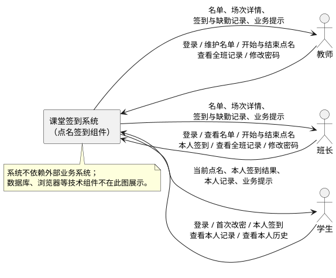
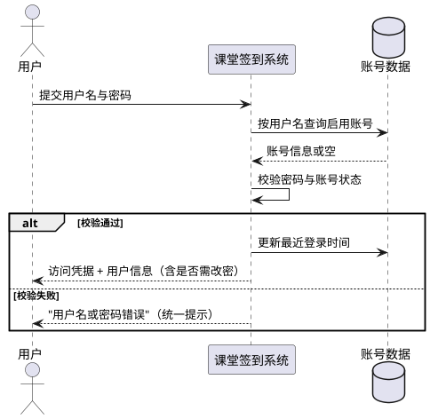
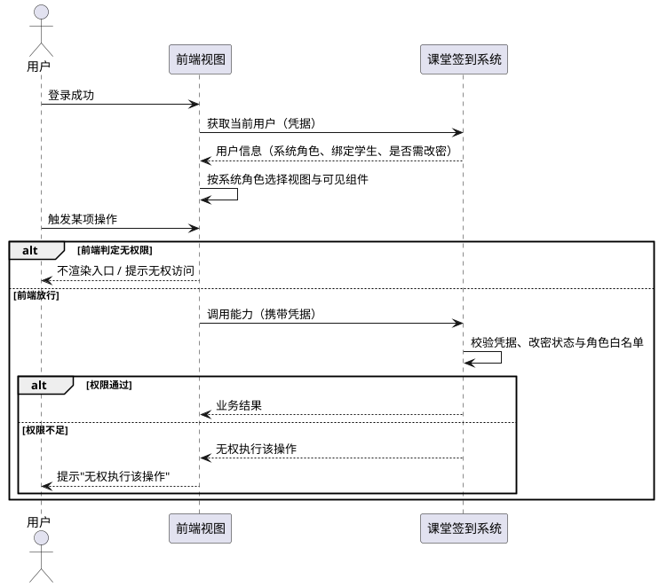
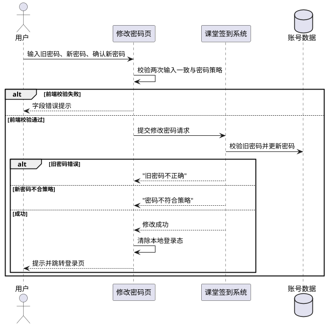
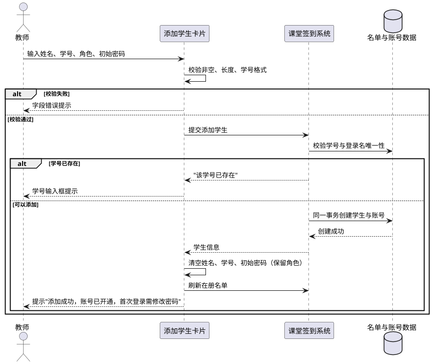
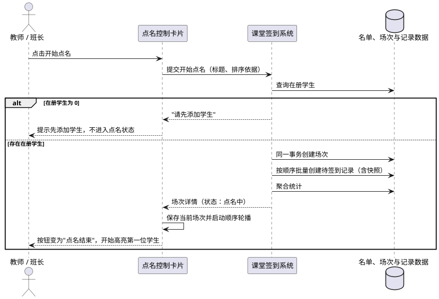
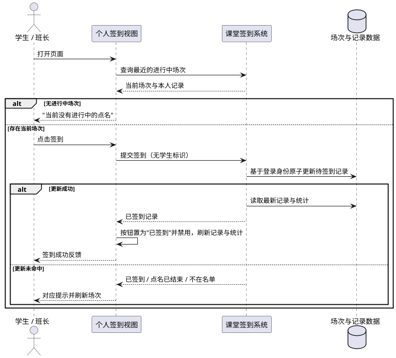
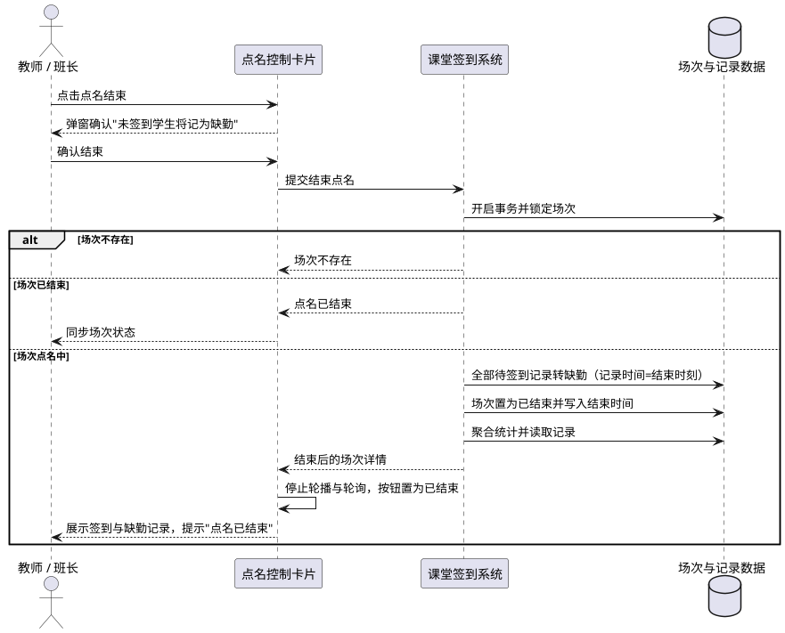
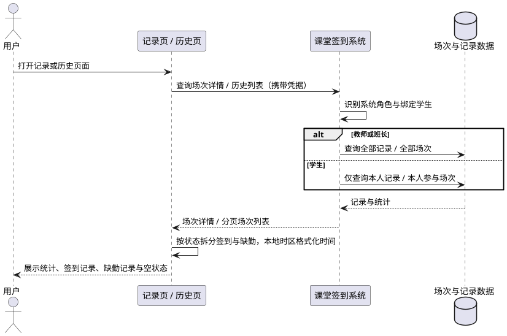

# 1. 组件定位

## 1.1 核心职责

本组件负责课堂点名与签到全流程，面向教师、班长、学生三类角色，实现名单维护、点名发起、本人签到、缺勤生成与记录追溯。

## 1.2 核心输入

1. **登录凭证**：教师、班长、学生提交的用户名与密码，来源为登录页。
2. **学生名单维护指令**：教师提交的姓名、学号、名单角色、初始密码与是否开通账号，来源为教师主页的添加学生卡片；以及教师对学生发起的删除操作。
3. **点名控制指令**：教师或班长提交的开始点名（可选标题、排序依据）与结束点名操作，来源为课堂管理页。
4. **本人签到指令**：已登录且绑定学生的账号提交的签到请求，请求中不携带学生身份，来源为学生主页或班长主页的签到按钮。
5. **密码变更指令**：已登录用户提交的旧密码与新密码，来源为首次改密页或顶栏修改密码入口。
6. **查询请求**：教师、班长、学生发起的名单查询、当前场次查询、场次详情查询、历史场次分页查询，来源为各页面加载、刷新、轮询与历史页。
7. **登录态凭据**：客户端在已登录状态下的访问令牌，用于标识当前操作者身份。

## 1.3 核心输出

1. **登录结果**：登录成功时返回访问凭据、有效期与当前用户信息；失败时返回统一的中文提示。
2. **学生名单**：按学号升序的在册学生集合，包含姓名、学号、名单角色、在册状态与创建时间。
3. **点名场次详情**：场次基本信息、总人数/已签到/缺勤/待签到统计，以及按点名顺序排列的记录集合（按角色过滤）。
4. **签到记录**：姓名、名单角色快照、学号快照、签到时间，供签到记录区展示。
5. **缺勤记录**：姓名、名单角色快照、学号快照与缺勤记录时间，供缺勤记录区展示。
6. **历史场次列表**：按开始时间倒序分页的场次集合，含统计字段。
7. **业务错误提示**：面向用户的明确中文提示（如"该学号已存在""点名已结束""无权执行该操作"）。
8. **可观测信息**：请求标识、访问路径、响应状态、耗时与关键业务操作日志；健康检查结果。

## 1.4 职责边界

1. 本组件**不负责**多教师隔离、多租户与学校统一身份认证（SSO）。
2. 本组件**不负责**学生自助注册、找回密码、邮箱或短信验证；学生与班长账号只能由教师添加学生时开通。
3. 本组件**不负责**人脸识别、定位签到、二维码签到等身份增强手段，签到的身份可信度来源于登录态与名单绑定关系。
4. 本组件**不负责**课程表、成绩管理与教学计划。
5. 本组件**不负责**实时多人推送；MVP 的同步能力限于前端定时轮询与手动刷新。
6. 本组件**不负责**学生信息的修改；MVP 仅提供添加与删除（删除为从名单移除，保留历史记录）。
7. 本组件**不负责**页面渲染细节与前端本地缓存策略；这些由前端设计承担，但展示内容必须以后端返回为准。
8. 本组件**不负责**数据库表结构、索引与迁移脚本的生产，也不负责部署编排；这些属于实现与运维范畴。

# 2. 领域术语

**名单角色**
: 学生名单中用于展示与历史快照的中文角色标签，取值为"学生""班长""教师"，与登录权限无关。

**系统角色**
: 登录账号的权限身份，取值为 `teacher`（教师）、`monitor`（班长）、`student`（学生），决定可见页面与可调用能力。

**在册学生**
: `active` 为真的学生，参与下一次点名；被删除的学生转为不在册，但其历史记录保留。

**点名场次**
: 一次完整的点名过程，由"开始点名"创建，具有"点名中"与"已结束"两种状态，所有签到与缺勤记录均挂载在场次下。

**点名中**
: 场次状态 `calling`，允许本场学生签到，禁止结束后的任何签到操作。

**已结束**
: 场次状态 `ended`，场次内所有待签到记录已转为缺勤，不可再次结束，也不可恢复为点名中。

**待签到**
: 记录状态 `pending`，表示该学生在本次场次中尚未签到，也未判定缺勤。

**已签到**
: 记录状态 `present`，表示该学生已在点名进行中完成本人签到，必然带有签到时间。

**缺勤**
: 记录状态 `absent`，表示场次结束时该学生仍未签到，缺勤时间记为场次结束时刻。

**点名顺序**
: 场次内每名学生的展示次序，由服务端在创建场次时固化，从 1 开始连续递增，刷新后不变。

**名单快照**
: 场次记录中冗余保存的姓名、学号与名单角色，用于保证学生信息后续变化不影响历史记录展示。

**初始密码**
: 教师添加学生并开通账号时设置的首次登录密码，默认等于学号；首次登录后必须先修改。

**强制改密**
: 账号标记为必须修改初始密码的状态；未完成改密前，除获取当前用户与修改密码外，业务能力一律拒绝。

**签到幂等**
: 同一学生在同一场次重复提交签到，系统只承认第一次成功，后续请求返回"已签到"，绝不产生第二条记录。

**当前点名**
: 学生视角下最近开始的"点名中"场次；不存在时学生看到"当前没有进行中的点名"。

# 3. 角色与边界

## 3.1 核心角色

**教师**：维护学生名单（添加、删除、查看），发起与结束点名，查看全班签到与缺勤记录及全部历史场次，修改本人密码。教师账号不绑定学生，因此不能签到。

**班长**：查看学生名单（只读），发起与结束点名，查看全班签到与缺勤记录及全部历史场次，完成本人签到，修改本人密码。

**学生**：查看当前点名并完成本人签到，查看本人的签到与缺勤记录及本人参与过的历史场次，修改本人密码（首次登录必须修改）。

## 3.2 外部系统

**无外部业务系统**：MVP 为单体 Web 应用，不依赖第三方身份认证、消息推送或支付等外部服务。

**浏览器环境**：作为运行载体提供页面渲染、本地存储与网络请求能力；其版本兼容性要求见 4.5。

**数据库**：作为数据持久化载体，由本组件通过统一数据访问语义读写；数据库属于技术组件，不计入 3.3 上下文图的交互方。

## 3.3 交互上下文

# 4. DFX约束

## 4.1 性能

1. 单个场次的在册学生人数上限为 200 人；超过该规模的名单不作为 MVP 支持范围。
2. 学生名单查询接口的 P95 响应时间必须小于 300 毫秒。
3. 本人签到接口的 P95 响应时间必须小于 200 毫秒（含网络）；服务端处理时间目标小于 50 毫秒。
4. 单场次详情查询的 P95 响应时间必须小于 100 毫秒。
5. 场次列表必须一次聚合统计，禁止按场次逐条查询统计；单页最多返回 100 条。
6. 前端在点名进行中的轮询间隔必须为 5 秒，轮播切换间隔必须为 3 秒；页面卸载时必须清理定时器。

## 4.2 可靠性

1. 点名场次的状态流转必须满足："点名中"只能转为"已结束"，"已结束"不可回退，不可重复结束。
2. 结束点名必须在单一事务内完成"待签到转缺勤"与"场次结束"；任一环节失败必须整体回滚，禁止出现"场次已结束但仍有待签到"的中间状态。
3. 已结束场次必须满足 `present_count + absent_count = total_count` 且 `pending_count = 0`；该条件作为数据一致性校验项。
4. 并发场景下，同一学生同时提交两次签到只能有一次成功；签到与结束点名并发时，最终状态必须一致且无待签到残留。
5. 添加学生与开通账号必须在同一事务内完成，禁止出现"有名单无账号"或"有账号无名单"。
6. 删除学生必须同时完成名单移出与账号禁用，历史记录不得被删除或改写。
7. 统计字段必须由服务端基于明细实时聚合，不得依赖前端计算，不得因缓存产生与明细不一致的结果。
8. 服务可用性目标与故障恢复时间上限：待定（本 MVP 未设定量化 SLA），但必须提供健康检查能力。

## 4.3 安全性

1. 除健康检查与登录外，所有能力必须要求已认证的访问凭据；缺失、伪造或过期凭据一律拒绝。
2. 访问凭据有效期必须为 8 小时（28800 秒）；过期后用户必须重新登录。
3. 用户名或密码错误、账号被禁用、账号不存在三种情况必须返回完全一致的用户提示，不得暴露账号是否存在。
4. 用户密码必须使用不可逆哈希存储，禁止以明文形式存储、传输回显或写入日志。
5. 签到身份必须取自当前登录账号绑定的学生，禁止信任客户端传入的学生标识或签到时间。
6. 权限校验必须同时在前端可见性与服务端拦截两层落实；前端隐藏不得作为唯一防线，直接调用越权能力必须被拒绝。
7. 角色权限必须遵循以下矩阵：

| 能力 | 教师 | 班长 | 学生 |
| --- | --- | --- | --- |
| 查看学生名单 | 允许 | 允许（只读） | 禁止 |
| 添加/删除学生 | 允许 | 禁止 | 禁止 |
| 开始/结束点名 | 允许 | 允许 | 禁止 |
| 查看全班签到/缺勤 | 允许 | 允许 | 禁止（仅本人） |
| 本人签到 | 禁止（未绑定学生） | 允许 | 允许 |
| 查看历史场次 | 全部 | 全部 | 仅本人参与 |
| 修改本人密码 | 允许 | 允许 | 允许（首次登录强制） |

8. 生产环境必须限制跨域来源，禁止使用通配来源搭配凭据；访问凭据的签名密钥必须通过环境变量注入，禁止写入代码仓库。
9. 数据查询必须采用参数化方式并受字段白名单约束，禁止拼接用户输入作为查询语句或排序依据。
10. 日志禁止记录密码、密码哈希、完整访问凭据；失败登录仅允许记录用户名与来源地址。
11. 未登录或凭据失效时，前端必须清除本地登录态并跳转登录页，不得继续渲染受保护内容。

## 4.4 可维护性

1. 每条请求日志必须包含请求标识、方法、路径、响应状态、耗时与错误码；已登录请求追加用户标识。
2. 关键业务操作必须记录日志：登录成功、登录失败、密码修改、场次开始、签到、场次结束。
3. 健康检查必须可独立访问且不要求认证，返回服务状态与版本。
4. 接口契约必须单一真源：任何路径、字段、错误码变更必须先更新契约文档，再同步服务端与前端类型；服务端自动生成的接口描述必须与契约一致。
5. 数据库结构变更必须通过版本化迁移完成，禁止在生产环境直接改表。
6. 前后端必须通过静态检查与自动化测试；后端接口测试必须覆盖认证、权限、业务规则与并发用例。

## 4.5 兼容性

1. 页面必须在 Chrome、Edge、Safari 最近两个大版本中正常使用。
2. 页面必须在宽度不小于 360 像素的移动设备上可用，无横向滚动，签到按钮最小点击区域为 44×44 像素。
3. 开发环境必须支持 SQLite，生产环境必须支持 PostgreSQL，两种环境下业务行为必须一致；行锁等方言差异不得影响结果正确性。
4. 接口兼容策略：新增字段必须可为空并提供默认值，禁止删除或重命名既有字段，禁止在未登记的情况下扩展响应字段。
5. 存量数据迁移必须保证学号、用户名等唯一性约束不冲突；已软删除学生的学号不可被复用。

# 5. 核心能力

## 5.1 登录与登录态

### 5.1.1 业务规则

1. **凭据登录**：用户必须通过用户名与密码登录；系统不提供任何注册入口。
   a. 验收条件：当用户提交存在的用户名与正确密码时，系统应当签发有效期 8 小时的访问凭据并返回当前用户信息，同时更新最近登录时间。
2. **统一失败提示**：用户名不存在、密码错误、账号被禁用三种情况必须返回同一句"用户名或密码错误"。
   a. 验收条件：当用户提交不存在的用户名时，系统应当返回与密码错误时完全相同的提示与状态。
   b. 验收条件：当被禁用账号尝试登录时，系统应当拒绝登录且提示与密码错误一致。
3. **账号来源约束**：教师账号只能由初始化流程创建；学生与班长账号只能由教师添加学生时开通，其登录名默认等于学号。
   a. 验收条件：当教师账号被初始化后，该账号应当可以登录且被标记为强制改密。
4. **登录态恢复**：已登录用户刷新页面时，系统必须能够依据访问凭据恢复当前用户信息。
   a. 验收条件：当已登录用户刷新页面时，系统应当返回当前用户信息并保持登录态；凭据无效时应当清除登录态并跳转登录页。
5. **登录页访问控制**：已登录用户访问登录页必须被重定向到角色主页。
   a. 验收条件：当已登录用户主动访问登录页时，系统应当跳转至该角色主页，而非再次展示登录表单。
6. **凭据过期**：访问凭据有效期届满后必须视为未登录。
   a. 验收条件：当凭据过期后调用任意受保护能力时，系统应当拒绝访问并提示"登录已过期，请重新登录"，前端清除登录态并跳转登录页。
7. **登出**：系统不提供服务端登出能力；登出由客户端清除访问凭据与本地登录态完成。
   a. 验收条件：当用户点击退出登录时，前端应当清除本地凭据与用户信息并跳转登录页，再次访问受保护页面必须被拦截。
8. **禁止项**：禁止在登录响应中返回密码、密码哈希或任何可用于还原密码的信息。
   a. 验收条件：当登录成功时，响应中的用户信息不包含密码相关字段。

### 5.1.2 交互流程

### 5.1.3 异常场景

1. **用户名或密码为空**
   a. 触发条件：登录表单提交时用户名或密码为空。
   b. 系统行为：拒绝提交，不发起认证请求。
   c. 用户感知：表单字段提示"请输入用户名/密码"。
2. **字段超长**
   a. 触发条件：用户名超过 32 字符或密码超过 64 字符。
   b. 系统行为：拒绝认证。
   c. 用户感知：提示"参数校验失败"并定位到对应字段。
3. **账号被禁用**
   a. 触发条件：学生被删除后其账号被禁用，仍尝试登录。
   b. 系统行为：按登录失败处理，不透露账号状态。
   c. 用户感知：提示"用户名或密码错误"。
4. **凭据缺失或伪造**
   a. 触发条件：未携带访问凭据或凭据签名无效访问受保护能力。
   b. 系统行为：拒绝请求，不执行任何业务逻辑。
   c. 用户感知：提示未登录，前端清除登录态并跳转登录页。
5. **网络异常**
   a. 触发条件：请求超时（10 秒）或网络不可达。
   b. 系统行为：保留当前页面状态，不修改登录态。
   c. 用户感知：提示"网络异常，请稍后重试"，允许重试。

## 5.2 角色权限与视图隔离

### 5.2.1 业务规则

1. **按角色渲染**：登录后必须依据系统角色进入不同视图；教师与班长共用课堂管理视图，学生进入个人签到视图，禁止仅通过样式隐藏来区分权限。
   a. 验收条件：当学生登录时，页面不得渲染添加学生、学生名单、点名控制与全班统计组件。
2. **能力白名单**：每个能力必须声明允许的系统角色；不在白名单内的调用一律拒绝。
   a. 验收条件：当班长调用添加或删除学生能力时，系统应当拒绝并提示"无权执行该操作"。
   b. 验收条件：当学生调用开始点名、结束点名或查看名单能力时，系统应当拒绝并提示"无权执行该操作"。
   c. 验收条件：当教师账号调用签到时，系统应当拒绝并提示"无权执行该操作"。
3. **双层拦截**：前端必须不渲染无权限入口；用户手动输入受保护地址或直接调用能力时，服务端必须再次拦截。
   a. 验收条件：当学生手动访问课堂管理地址时，前端应当重定向至主页并提示"无权访问"，服务端同时拒绝相关请求。
4. **角色与名单角色分离**：展示用的名单角色取场次创建时的快照值，与登录权限无关；名单角色"教师"仅为历史展示值，MVP 的添加表单不得提供该选项。
   a. 验收条件：当班长完成签到时，其签到记录展示的角色为"班长"，但其系统权限仍为班长能力集。
5. **数据可见范围**：教师与班长可查看全班记录与全部历史场次；学生只能查看本人记录与本人参与过的场次。
   a. 验收条件：当学生查询场次详情时，响应中只包含该学生本人的记录。
   b. 验收条件：当学生查询一个本人未参与的场次时，系统应当返回空记录集合而非错误。
   c. 验收条件：当学生查询历史场次列表时，结果只包含本人存在记录的场次。
6. **禁止项**：禁止通过前端传入的角色、用户标识或学生标识提升权限。
   a. 验收条件：当请求中携带伪造的角色或学生标识时，系统应当忽略并按登录态真实身份处理。

### 5.2.2 交互流程

### 5.2.3 异常场景

1. **角色不匹配访问页面**
   a. 触发条件：用户访问与其系统角色不匹配的页面地址。
   b. 系统行为：前端守卫重定向到主页并提示；服务端对相关请求返回权限不足。
   c. 用户感知：提示"无权访问"/"无权执行该操作"，页面不跳转到业务页。
2. **登录态在操作过程中失效**
   a. 触发条件：操作期间凭据过期或被清除。
   b. 系统行为：中止操作，清除本地登录态。
   c. 用户感知：提示"登录已过期，请重新登录"并跳转登录页。
3. **未完成强制改密仍调用业务能力**
   a. 触发条件：账号标记为强制改密，用户未改密即调用业务能力。
   b. 系统行为：拒绝业务请求，不改动任何业务数据。
   c. 用户感知：被跳转至修改密码页。

## 5.3 密码管理

### 5.3.1 业务规则

1. **新密码策略**：新密码长度必须为 8–64 位，且至少包含 1 个字母与 1 个数字。
   a. 验收条件：当新密码为 7 位纯数字时，系统应当拒绝并提示密码不符合策略。
   b. 验收条件：当新密码为 8 位且同时包含字母与数字时，系统应当接受。
2. **新旧密码不同**：新密码不得与旧密码相同。
   a. 验收条件：当用户提交与旧密码相同的新密码时，系统应当拒绝并提示。
3. **旧密码校验**：修改密码必须先校验旧密码。
   a. 验收条件：当旧密码错误时，系统应当拒绝修改并提示"旧密码不正确"，不得更新密码。
4. **强制改密**：账号标记为强制改密时，用户登录后必须停留在修改密码页；未完成改密前，除获取当前用户与修改密码外，业务能力一律拒绝。
   a. 验收条件：当强制改密用户尝试签到或查看记录时，系统应当拒绝并提示"需先修改初始密码"，前端跳转改密页。
   b. 验收条件：当强制改密用户完成改密后，业务能力应当立即恢复可用。
5. **改密后重新登录**：修改密码成功后必须清除当前登录态并要求重新登录，旧密码立即失效。
   a. 验收条件：当改密成功后，使用旧密码登录应当失败，使用新密码登录应当成功。
   b. 验收条件：当改密成功后，前端应当清除访问凭据并跳转登录页。
6. **改密入口**：首次登录强制改密与顶栏主动修改密码必须使用同一修改流程。
   a. 验收条件：当用户从顶栏进入修改密码并成功提交时，系统应当同样要求重新登录。
7. **禁止项**：MVP 不提供由教师或管理员重置他人密码的能力，也不提供找回密码能力。
   a. 验收条件：当用户忘记密码时，页面不提供自助找回入口。

### 5.3.2 交互流程

### 5.3.3 异常场景

1. **两次新密码不一致**
   a. 触发条件：新密码与确认新密码输入不同。
   b. 系统行为：不提交请求。
   c. 用户感知：确认密码字段提示"两次输入的密码不一致"。
2. **新密码过弱**
   a. 触发条件：新密码长度不足 8 位、超过 64 位或缺少字母/数字。
   b. 系统行为：拒绝更新密码。
   c. 用户感知：提示"密码需为 8–64 位且包含字母和数字"。
3. **旧密码错误**
   a. 触发条件：提交的旧密码与当前密码不匹配。
   b. 系统行为：不更新密码，不改变强制改密标记。
   c. 用户感知：提示"旧密码不正确"。
4. **新密码与旧密码相同**
   a. 触发条件：新密码与旧密码完全一致。
   b. 系统行为：拒绝修改。
   c. 用户感知：提示"新密码不能与旧密码相同"。
5. **提交期间重复点击**
   a. 触发条件：用户连续点击提交按钮。
   b. 系统行为：提交期间禁用按钮，仅处理一次请求。
   c. 用户感知：按钮呈加载态，无重复提示。

## 5.4 学生名单管理

### 5.4.1 业务规则

1. **添加学生**：教师必须能够录入姓名、学号、名单角色与可选初始密码，并在同一操作中为学生开通登录账号。
   a. 验收条件：当教师提交合法姓名与学号时，名单应当立即出现该学生，并自动开通登录名为学号的账号。
2. **字段校验**：姓名与学号去除首尾空格后长度必须为 1–32 字符，姓名不得为纯空白；学号只允许字母、数字、下划线与连字符。
   a. 验收条件：当学号包含空格或中文时，系统应当拒绝并提示参数校验失败。
   b. 验收条件：当姓名为 31 个字符时应当接受，为 33 个字符时应当拒绝。
3. **学号唯一**：学号必须全局唯一，包括已从名单删除的学生；学号不可复用。
   a. 验收条件：当教师添加已存在的学号时，系统应当拒绝并提示"该学号已存在"，学号输入框标红提示。
4. **角色取值**：名单角色只能为"学生"或"班长"，默认"学生"；MVP 添加表单不得提交"教师"。
   a. 验收条件：当提交名单角色为"教师"时，系统应当拒绝并提示参数校验失败。
5. **账号开通**：添加学生时默认开通账号，登录名等于学号；名单角色"学生"映射系统角色 `student`，"班长"映射 `monitor`；账号必须标记为强制改密。
   a. 验收条件：当教师添加名单角色为班长的学生时，其账号系统角色应当为 `monitor`，且首次登录被要求改密。
6. **初始密码规则**：初始密码长度必须为 6–32 字符；未填写时默认等于学号。
   a. 验收条件：当教师未填写初始密码时，该账号应当可以使用学号登录。
   b. 验收条件：当初始密码为 5 位时，系统应当拒绝并提示初始密码长度不符合要求。
7. **可选择不开通账号**：教师可以选择仅加入名单而不开通账号。
   a. 验收条件：当教师关闭账号开通选项时，系统应当只创建名单记录，不创建登录账号。
8. **原子性**：学生名单与账号必须同时创建成功或同时失败；禁止出现名单已添加但账号缺失的半成品状态。
   a. 验收条件：当账号创建失败时，该次添加应当整体失败，名单中不得出现该学生。
9. **名单查询**：教师与班长必须能够查看在册学生名单，按学号升序排列；支持按姓名或学号模糊搜索；支持查看历史（含已删除）名单。
   a. 验收条件：当查询关键字为"张"时，结果应当包含姓名或学号匹配的学生。
   b. 验收条件：当默认加载名单时，只应返回在册学生。
10. **名单规模**：MVP 名单一次性返回全量，不做分页；单课堂规模上限为 200 人。
    a. 验收条件：当在册学生为 200 人时，名单应当一次完整返回并保持学号升序。
11. **删除学生**：教师必须能够删除学生；删除为从名单移除，保留全部历史记录，同时禁用其登录账号。
    a. 验收条件：当教师删除学生后，该学生不再出现在默认名单中，其账号无法登录。
    b. 验收条件：当教师删除学生后，该学生既往场次的签到与缺勤记录仍可正常查看，记录内容不变。
12. **删除确认与幂等**：删除必须二次确认；重复删除必须返回"学生不存在"。
    a. 验收条件：当教师对同一学生连续删除两次时，第二次应当提示学生不存在。
13. **点名中的名单变更**：点名进行中删除或添加学生只影响下一次场次，不得改写当前场次的记录。
    a. 验收条件：当点名进行中删除某学生时，当前场次中该学生的记录状态保持不变，页面提示"修改将在下次点名生效"。
14. **只读边界**：班长只能查看名单，不得添加或删除；学生不得查看名单。
    a. 验收条件：当班长登录时，添加学生卡片与删除操作应当不渲染。
15. **禁止项**：MVP 不提供修改学生姓名、学号或角色的能力。
    a. 验收条件：当教师试图修改学生信息时，页面不提供该入口。

### 5.4.2 交互流程

### 5.4.3 异常场景

1. **姓名为空或纯空白**
   a. 触发条件：教师未填写姓名或只输入空格。
   b. 系统行为：拒绝提交。
   c. 用户感知：姓名输入框提示"请输入姓名"。
2. **学号格式非法**
   a. 触发条件：学号包含字母数字下划线连字符之外的字符。
   b. 系统行为：拒绝提交。
   c. 用户感知：学号输入框提示格式要求。
3. **学号重复**
   a. 触发条件：提交的学号已存在，或已被软删除。
   b. 系统行为：不创建学生与账号。
   c. 用户感知：提示"该学号已存在"，输入框红色边框 3 秒。
4. **登录名冲突**
   a. 触发条件：生成的登录名已被其他账号占用。
   b. 系统行为：整体回滚，不创建名单。
   c. 用户感知：提示账号冲突，建议联系管理员。
5. **初始密码长度非法**
   a. 触发条件：初始密码少于 6 位或多于 32 位。
   b. 系统行为：拒绝添加。
   c. 用户感知：初始密码字段提示长度要求。
6. **账号创建失败**
   a. 触发条件：账号写入异常。
   b. 系统行为：回滚整个添加操作。
   c. 用户感知：提示添加失败，允许重试，名单中无该学生。
7. **名单为空**
   a. 触发条件：在册学生为 0 时加载名单。
   b. 系统行为：返回空集合。
   c. 用户感知：显示空状态"还没有学生，请先添加"。
8. **删除不存在的学生**
   a. 触发条件：删除已删除或不存在的学生。
   b. 系统行为：不产生任何变更。
   c. 用户感知：提示"学生不存在"并刷新名单。
9. **重复提交**
   a. 触发条件：添加或删除按钮在请求期间被重复点击。
   b. 系统行为：仅处理一次请求。
   c. 用户感知：按钮禁用，无重复记录产生。

## 5.5 开始点名

### 5.5.1 业务规则

1. **发起权限**：只有教师与班长可以开始点名；学生不得发起。
   a. 验收条件：当学生调用开始点名时，系统应当拒绝并提示无权执行该操作。
2. **在场名单**：开始点名必须读取当前全部在册学生作为参与人，不在册（已删除）学生不参与。
   a. 验收条件：当名单中有 3 名在册学生与 1 名已删除学生时，新场次的记录应为 3 条。
3. **空名单拦截**：在册学生为 0 时禁止开始点名，且不得创建场次。
   a. 验收条件：当名单为空时点击开始点名，系统应当拒绝并提示"请先添加学生"，历史场次数量不增加。
4. **场次创建**：开始点名必须创建一次新的点名场次，状态为"点名中"，开始时间为服务端当前时间。
   a. 验收条件：当教师开始点名时，系统应当返回新场次及其全部记录，场次状态为点名中。
5. **标题**：场次标题可由发起人自定义，长度 1–64 字符；未填写时由服务端按"YYYY-MM-DD 课堂点名"生成。
   a. 验收条件：当未提供标题时，场次标题应当为当天日期加"课堂点名"。
   b. 验收条件：当标题为 65 字符时，系统应当拒绝并提示参数校验失败。
6. **点名顺序**：创建场次时必须为每名学生固化点名顺序，从 1 开始连续递增；可按学号（默认）、姓名或学生标识排序。
   a. 验收条件：当按学号排序时，第 1 位应当是学号最小的学生，顺序号连续且无重复。
   b. 验收条件：当页面刷新后重新获取场次详情时，记录顺序必须与创建时一致。
7. **待签到初始化**：场次内每名学生的初始记录状态必须为"待签到"，签到时间为空。
   a. 验收条件：当开始点名成功时，总人数等于待签到人数，已签到与缺勤均为 0。
8. **快照写入**：记录必须保存创建时刻的姓名、学号与名单角色快照。
   a. 验收条件：当学生姓名在下次点名前被变更（非 MVP 能力）或场次创建后名单调整时，历史场次的快照展示不得改变。
9. **多场次并存**：系统不限制进行中场次的数量；学生视图以最近开始的点名中场次作为当前点名。
   a. 验收条件：当存在多个点名中场次时，学生端应当展示开始时间最新的一个。
10. **原子性**：场次与全部记录必须在同一事务内创建，任一记录写入失败必须整体回滚。
    a. 验收条件：当记录批量写入失败时，系统中不得残留空场次。
11. **重复发起**：开始点名按钮在请求期间必须禁用，防止重复创建场次。
    a. 验收条件：当发起人连续点击开始点名时，只应创建一个场次。
12. **禁止项**：禁止对已结束场次执行开始点名以"重新开始"；再次点名必须创建新场次。
    a. 验收条件：当对已结束场次发起重新开始时，系统不提供该能力，用户只能发起新点名。

### 5.5.2 交互流程

### 5.5.3 异常场景

1. **名单为空**
   a. 触发条件：在册学生为 0。
   b. 系统行为：拒绝创建场次，不产生任何记录。
   c. 用户感知：提示"请先添加学生"，开始按钮保持禁用或提示后不改变状态。
2. **排序依据非法**
   a. 触发条件：提交的排序依据不在允许集合内。
   b. 系统行为：拒绝创建场次。
   c. 用户感知：提示参数校验失败。
3. **标题超长或为空字符串**
   a. 触发条件：标题长度超过 64 字符或去空格后为空。
   b. 系统行为：拒绝创建场次。
   c. 用户感知：标题字段提示长度要求。
4. **创建过程中写入失败**
   a. 触发条件：场次或记录写入异常。
   b. 系统行为：整体回滚，不留下空场次与部分记录。
   c. 用户感知：提示"开始点名失败，请重试"。
5. **重复点击**
   a. 触发条件：发起人连续点击开始点名。
   b. 系统行为：请求期间禁用按钮，仅创建一次场次。
   c. 用户感知：按钮呈加载态。
6. **并发发起**
   a. 触发条件：教师与班长在同一时刻发起点名。
   b. 系统行为：各自创建独立场次，记录互不干扰。
   c. 用户感知：双方分别进入自己的当前场次，学生端展示最新开始的场次。

## 5.6 学生签到

### 5.6.1 业务规则

1. **签到身份**：签到必须使用当前登录账号所绑定的学生身份，禁止接受客户端传入的学生标识或签到时间。
   a. 验收条件：当请求中携带其他学生的标识时，系统应当忽略该字段，仍按登录账号绑定学生处理。
2. **绑定要求**：只有绑定了学生且系统角色为学生或班长的账号可以签到；教师账号及无绑定账号不得签到。
   a. 验收条件：当教师账号调用签到时，系统应当拒绝并提示无权执行该操作。
3. **场次要求**：签到必须针对存在且状态为"点名中"的场次。
   a. 验收条件：当场次不存在时，系统应当提示场次不存在并引导刷新。
   b. 验收条件：当场次已结束时，系统应当拒绝签到并提示"点名已结束"。
4. **在场要求**：当前账号绑定的学生必须属于该场次。
   a. 验收条件：当学生在场次创建后才被添加时，其签到应当被拒绝并提示"你不在本次点名名单中"。
5. **待签到前置**：只有状态为"待签到"的记录可以转为"已签到"。
   a. 验收条件：当记录已是"已签到"时，重复签到应当被拒绝并提示"该学生已签到"。
   b. 验收条件：当记录已是"缺勤"时，签到应当被拒绝并提示点名已结束。
6. **幂等保证**：同一学生在同一场次只能存在一条记录，重复签到不得产生第二条记录。
   a. 验收条件：当学生连续点击签到 3 次时，系统中该场次该学生仍只有 1 条记录，状态为已签到。
7. **签到时间**：签到时间必须由服务端生成，不得使用客户端时间。
   a. 验收条件：当学生签到成功时，记录的签到时间应当接近服务端当前时间，且与客户端时区无关。
8. **并发安全**：同一学生并发提交签到只能成功一次；签到与结束点名并发时不得出现数据丢失或状态错乱。
   a. 验收条件：当同一学生同时发起两次签到请求时，恰好一次成功，另一次返回已签到或点名已结束。
   b. 验收条件：当签到与结束点名并发时，最终该记录为已签到或缺勤之一，不得残留待签到。
9. **状态反馈**：签到成功后按钮必须变为"已签到"并禁用，同时刷新统计与签到记录区。
   a. 验收条件：当签到成功时，签到记录区应当新增该学生的姓名、角色、学号与签到时间，已签到人数加 1、待签到人数减 1。
10. **强制改密前置**：未完成强制改密的账号必须拒绝签到。
    a. 验收条件：当强制改密学生调用签到时，系统应当提示需先修改初始密码并跳转改密页。
11. **禁止代签**：教师与班长视图不得提供代签按钮；签到只能由学生本人在自己设备完成。
    a. 验收条件：当教师或班长进入课堂管理页时，页面不出现代签入口。
12. **禁止项**：禁止在已结束场次上补签或修改签到结果。
    a. 验收条件：当场次结束后尝试签到或变更签到状态时，系统应当拒绝。

### 5.6.2 交互流程

### 5.6.3 异常场景

1. **重复签到**
   a. 触发条件：学生对已签到记录再次提交。
   b. 系统行为：不修改记录，不产生新记录。
   c. 用户感知：提示"该学生已签到"，按钮保持"已签到"。
2. **场次已结束**
   a. 触发条件：场次结束时间早于签到请求处理时间。
   b. 系统行为：拒绝签到。
   c. 用户感知：提示"点名已结束"，刷新场次并禁用签到按钮。
3. **学生不在本场**
   a. 触发条件：登录绑定学生在此场次无记录。
   b. 系统行为：拒绝签到。
   c. 用户感知：提示"你不在本次点名名单中"并刷新场次。
4. **无进行中场次**
   a. 触发条件：学生进入页面时无点名中场次。
   b. 系统行为：返回空场次。
   c. 用户感知：显示"当前没有进行中的点名"，不展示签到按钮。
5. **场次不存在**
   a. 触发条件：本地缓存的场次已被删除或标识失效。
   b. 系统行为：返回场次不存在。
   c. 用户感知：清除本地缓存，回到未开始状态并刷新。
6. **轮询覆盖本地状态**
   a. 触发条件：轮询结果比本地状态旧。
   b. 系统行为：按"已签到 > 缺勤 > 待签到"的优先级合并，以更新状态为准。
   c. 用户感知：已签到状态不会被回退为待签到。
7. **其他设备结束场次**
   a. 触发条件：轮询发现场次已结束。
   b. 系统行为：停止轮询，切换按钮状态并刷新缺勤记录。
   c. 用户感知：提示点名已结束，签到按钮禁用。
8. **网络异常**
   a. 触发条件：签到请求超时或网络不可达。
   b. 系统行为：不修改本地记录状态。
   c. 用户感知：提示"网络异常，请稍后重试"，保留页面状态。

## 5.7 结束点名与缺勤生成

### 5.7.1 业务规则

1. **结束权限**：只有教师与班长可以结束点名；学生不得结束。
   a. 验收条件：当学生调用结束点名时，系统应当拒绝并提示无权执行该操作。
2. **状态前置**：只有"点名中"的场次可以结束；已结束场次不得重复结束。
   a. 验收条件：当对已结束场次再次结束点名时，系统应当拒绝并提示"点名已结束"。
3. **缺勤生成**：结束时必须将该场次全部"待签到"记录转为"缺勤"。
   a. 验收条件：当 3 人场次中 1 人已签到、2 人待签到时，结束后缺勤记录应当为 2 条。
4. **缺勤时间**：缺勤时间必须统一记为场次结束时刻，且与场次结束时间一致。
   a. 验收条件：当结束点名成功时，全部缺勤记录的记录时间应当等于场次的结束时间。
5. **场次结束**：结束时必须将场次状态置为"已结束"并记录结束时间。
   a. 验收条件：当结束点名成功时，场次状态为已结束、结束时间非空。
6. **一致性**：结束操作必须在单一事务内完成，结束后必须满足已签到数加缺勤数等于总人数，待签到数为 0。
   a. 验收条件：当结束点名成功时，场次统计满足 `present_count + absent_count = total_count` 且 `pending_count = 0`。
7. **确认交互**：结束前必须弹出确认提示"结束后未签到学生将记为缺勤，确认结束？"。
   a. 验收条件：当用户点击点名结束后未确认时，系统不得发起结束请求。
8. **结束后的不可变性**：场次结束后，签到与缺勤结果不得再变化，也不可恢复为点名中。
   a. 验收条件：当场次结束后任何签到、补签或状态变更请求均应当被拒绝。
9. **结果返回**：结束成功后必须返回场次统计与完整记录，供页面刷新签到与缺勤两个区域。
   a. 验收条件：当结束成功时，页面应当展示签到记录与缺勤记录，停止轮播与轮询，按钮置为"已结束"。
10. **并发防重**：并发结束同一场次时只能成功一次。
    a. 验收条件：当两名班长同时结束同一场次时，仅一次成功，另一次提示点名已结束。
11. **禁止项**：禁止在缺勤生成后手工删除缺勤记录或将其改回待签到。
    a. 验收条件：当尝试删除或回退缺勤记录时，系统不提供该能力。

### 5.7.2 交互流程

### 5.7.3 异常场景

1. **场次不存在**
   a. 触发条件：结束的场次标识无效或已被删除。
   b. 系统行为：不执行任何更新。
   c. 用户感知：提示场次不存在，返回主页面并刷新。
2. **重复结束**
   a. 触发条件：场次已结束仍提交结束请求。
   b. 系统行为：不重复生成缺勤。
   c. 用户感知：提示"点名已结束"并同步场次状态。
3. **并发结束**
   a. 触发条件：两个客户端同时结束同一场次。
   b. 系统行为：仅一个请求生效，另一个按已结束处理。
   c. 用户感知：失败方提示点名已结束并刷新。
4. **结束过程中异常**
   a. 触发条件：缺勤更新或场次更新失败。
   b. 系统行为：整体回滚，场次仍为点名中，记录保持原状态。
   c. 用户感知：提示结束失败，允许重试。
5. **结束与签到并发**
   a. 触发条件：学生签到请求与结束请求同时到达。
   b. 系统行为：仅一方状态更新生效，最终无待签到残留。
   c. 用户感知：签到方若落败收到"点名已结束"，结束方看到一致统计。
6. **网络中断**
   a. 触发条件：结束请求超时。
   b. 系统行为：不假定成功，保留页面当前状态。
   c. 用户感知：提示网络异常，用户重试后得到一致结果。

## 5.8 签到、缺勤与历史记录

### 5.8.1 业务规则

1. **签到记录展示**：签到记录必须展示姓名、名单角色、学号与签到时间，按点名顺序排列。
   a. 验收条件：当场次有 2 人已签到时，签到记录区应展示 2 行，每行含四项信息。
2. **缺勤记录展示**：缺勤记录必须展示姓名、名单角色、学号与记录时间，且只在场次结束后展示。
   a. 验收条件：当场次处于点名中时，缺勤区应当显示占位"点名结束后生成"。
   b. 验收条件：当场次结束后无人缺勤时，应当显示"本次无人缺勤"。
3. **统计展示**：页面必须展示总人数、已签到人数、缺勤人数与待签到人数，取值为服务端聚合结果。
   a. 验收条件：当签到成功后，统计应当立即变化，且与记录明细一致。
4. **时间展示**：时间必须按浏览器本地时区展示为 `YYYY-MM-DD HH:mm:ss`；空时间必须显示"—"。
   a. 验收条件：当签到时间为空时，页面不得显示"Invalid Date"。
5. **学生记录范围**：学生只能看到本人的签到与缺勤记录，不得看到其他学生信息。
   a. 验收条件：当学生查看场次详情时，页面只展示本人一行记录。
6. **历史列表**：教师与班长必须能够分页查看全部历史场次，学生只能查看本人参与过的场次；列表按开始时间倒序。
   a. 验收条件：当教师查看历史时，应当看到全部场次；当学生查看历史时，只应看到本人存在记录的场次。
7. **分页约束**：分页页码从 1 开始，每页默认 20 条、最大 100 条；可按场次状态过滤。
   a. 验收条件：当请求每页 100 条时应当接受，请求 101 条时应当拒绝并提示参数校验失败。
   b. 验收条件：当按"已结束"过滤时，列表只包含已结束场次。
8. **历史明细**：点击历史场次必须能够查看该场次详情；教师与班长看到全部记录，学生只看到本人记录。
   a. 验收条件：当学生打开本人参与场次的详情时，响应只包含本人记录。
9. **刷新恢复**：页面刷新后必须能够恢复进行中的场次与当前记录状态。
   a. 验收条件：当教师刷新页面时，若存在本人发起的进行中场次，应当恢复轮播与"点名结束"按钮状态。
   b. 验收条件：当缓存场次已失效时，应当清除本地缓存并回到未开始状态。
10. **多端同步**：点名进行中必须通过 5 秒轮询同步签到结果与场次状态；页面卸载时必须停止轮询。
    a. 验收条件：当另一台设备完成签到时，当前页面最迟在 5 秒后看到更新。
11. **空状态**：无记录时必须有明确空状态文案，不得展示空白表格。
    a. 验收条件：当无签到记录时显示"暂无签到记录"；当无历史场次时显示对应空状态。
12. **禁止项**：禁止在前端二次过滤学生记录以替代服务端的可见范围控制。
    a. 验收条件：当学生收到场次详情时，响应本身不包含他人记录。

### 5.8.2 交互流程

### 5.8.3 异常场景

1. **场次不存在**
   a. 触发条件：查询的场次标识无效。
   b. 系统行为：不返回任何记录。
   c. 用户感知：提示场次不存在，返回主页面并刷新。
2. **学生查询未参与场次**
   a. 触发条件：学生查询一个本人无记录的场次。
   b. 系统行为：返回场次信息与空记录集合，不报错。
   c. 用户感知：页面展示该场次但无本人记录。
3. **分页参数越界**
   a. 触发条件：页码小于 1 或每页数量超出 1–100。
   b. 系统行为：拒绝查询。
   c. 用户感知：提示参数校验失败。
4. **状态过滤值非法**
   a. 触发条件：状态参数不是点名中或已结束。
   b. 系统行为：拒绝查询。
   c. 用户感知：提示参数校验失败。
5. **时间缺失**
   a. 触发条件：记录签到时间为空（待签到）。
   b. 系统行为：按空值返回。
   c. 用户感知：时间列显示"—"。
6. **轮询失败**
   a. 触发条件：轮询请求连续失败。
   b. 系统行为：保留页面已有数据，不覆盖为空白。
   c. 用户感知：保留当前展示，恢复网络后自动继续轮询。

# 6. 数据约束

## 6.1 登录账号

1. **用户名**：必填，去除首尾空格后长度 1–32 字符，全局唯一；学生与班长账号默认等于学号。
2. **密码凭据**：必填，必须以不可逆哈希形式保存，禁止保存或返回明文。
3. **系统角色**：必填，取值只能为 `teacher`、`monitor`、`student`。
4. **显示名称**：必填，长度 1–32 字符；学生与班长为姓名，教师为自定义名称。
5. **绑定学生**：教师账号必须为空；学生与班长账号必须绑定且只能绑定一个学生，同一学生至多绑定一个账号。
6. **强制改密标记**：必填，默认"是"；完成首次改密后置为"否"。
7. **启用状态**：必填，默认启用；学生被删除时必须同步置为禁用。
8. **最近登录时间**：可空；登录成功后更新为服务端当前时间。
9. **创建时间**：必填，由服务端生成。

## 6.2 学生

1. **学号**：必填，去除首尾空格后长度 1–32 字符，只允许字母、数字、下划线与连字符，全局唯一，软删除后不可复用。
2. **姓名**：必填，去除首尾空格后长度 1–32 字符，不得为纯空白。
3. **名单角色**：必填，取值只能为"学生""班长""教师"，默认"学生"；MVP 新增学生的输入只允许"学生""班长"。
4. **在册状态**：必填，默认在册；删除操作将其置为不在册。
5. **创建时间**：必填，由服务端生成。

## 6.3 点名场次

1. **标题**：必填，长度 1–64 字符；未提供时由服务端生成"YYYY-MM-DD 课堂点名"。
2. **状态**：必填，取值只能为"点名中"或"已结束"，默认"点名中"。
3. **排序依据**：必填，取值只能为学号、姓名或学生标识，默认学号。
4. **开始时间**：必填，由服务端生成。
5. **结束时间**：点名中时为空；已结束时必填且不得早于开始时间。
6. **状态与结束时间一致性**：点名中必须无结束时间；已结束必须有结束时间。
7. **统计一致性**：总人数、已签到数、缺勤数、待签到数必须基于明细实时聚合，且始终满足总人数等于三者之和；已结束场次的待签到数必须为 0。

## 6.4 签到记录

1. **场次与学生**：必填，同一场次与同一学生只能存在一条记录。
2. **点名顺序**：必填，取值不小于 1，同一场次内连续递增且唯一。
3. **学号快照**：必填，长度 1–32 字符，取创建场次时的学号。
4. **姓名快照**：必填，长度 1–32 字符，取创建场次时的姓名。
5. **名单角色快照**：必填，取值只能为"学生""班长""教师"，取创建场次时的角色。
6. **状态**：必填，取值只能为"待签到""已签到""缺勤"，默认"待签到"。
7. **签到时间**：已签到时必填且由服务端生成；缺勤时必须为场次结束时刻；待签到时必须为空。
8. **状态不可逆**：已签到与缺勤状态在正常业务中不可回退；场次结束后的记录不得再变更。
9. **历史不可变**：记录中的姓名、学号与角色快照不随学生信息变化而变化；学生被删除后记录仍保留。