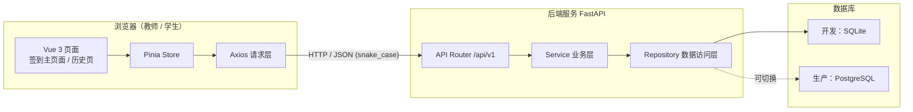
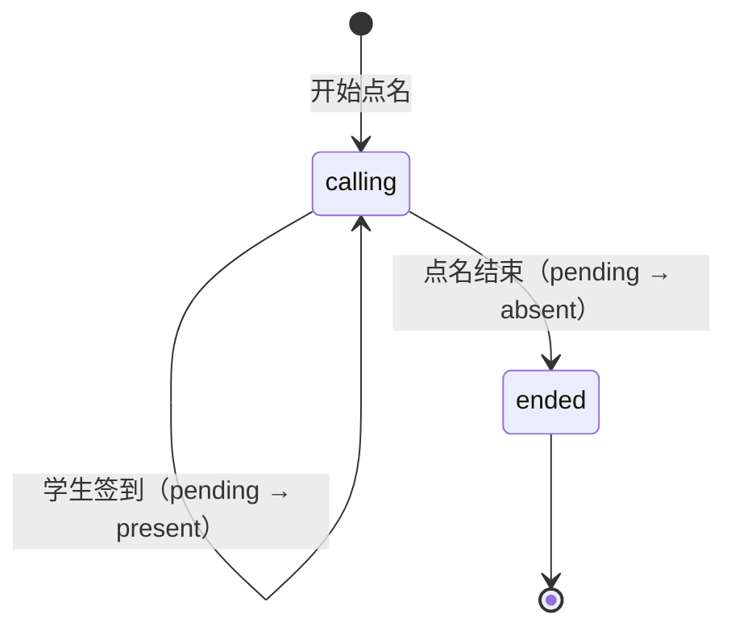

# 教师点名签到系统 · 总体架构

> 文档版本：v1.0（设计阶段）
> 适用范围：MVP 第一版
> 维护方式：三人共同评审；任何接口变更必须先修改本文档第 7 章，再改代码。

---

## 1. 项目概述

### 1.1 背景

课堂点名长期依赖纸质名单或口头应答，存在效率低、记录难统计、缺勤追溯困难等问题。本项目提供一个轻量的 Web 应用：教师维护学生名单，一键发起点名；学生在同一页面完成签到；系统自动记录签到与缺勤，支持课后查询。

### 1.2 目标

- 教师可在浏览器中完成：添加学生、开始点名、结束点名、查看签到与缺勤记录。
- 学生可在点名进行中点击"签到"完成签到。
- 点名结束后，未签到学生自动进入缺勤记录。
- 页面简洁、美观、移动端可用。
- 三人可并行开发，前后端与数据库契约完全一致。

### 1.3 范围

**MVP 必须实现**

| 编号 | 能力 | 说明 |
| --- | --- | --- |
| F1 | 学生名单管理 | 添加学生（姓名、学号、角色）、查看名单、删除学生 |
| F2 | 开始点名 | 基于当前名单创建一次点名场次，按学号顺序点名 |
| F3 | 学生签到 | 点名进行中，学生点击"签到"，幂等校验防重复 |
| F4 | 结束点名 | 结束场次，未签到学生自动记为缺勤 |
| F5 | 签到记录 | 展示姓名、角色、学号、签到时间 |
| F6 | 缺勤记录 | 展示本次缺勤学生姓名、角色、学号 |
| F7 | 历史场次 | 查看历史点名场次的统计与明细（P1，接口预留） |

**明确不做（后续版本）**

- 账号体系、登录鉴权、多教师隔离（MVP 采用单课堂单实例）。
- 人脸识别、定位签到、二维码签到。
- 学生自助注册、课程表、成绩管理。
- 实时多人推送（MVP 采用前端轮询 + 手动刷新）。

---

## 2. 技术选型

| 层 | 技术 | 版本建议 | 选型理由 |
| --- | --- | --- | --- |
| 前端 | Vue 3 + Vite + TypeScript | Vue 3.5 / Vite 6 | 组合式 API 上手快，构建快，适合三人小团队 |
| UI | Element Plus | 2.x | 表格、表单、按钮、消息组件齐全，风格简洁 |
| 状态 | Pinia | 2.x | 轻量，适合管理名单、场次、记录三类状态 |
| 路由 | Vue Router | 4.x | 主页面与历史页切换 |
| 请求 | Axios | 1.x | 统一封装拦截器与错误提示 |
| 后端 | Python 3.12 + FastAPI | FastAPI 0.115+ | 自动生成 OpenAPI，Pydantic 校验强，开发效率高 |
| ORM | SQLAlchemy 2.0 | 2.0+ | 同时兼容 SQLite 与 PostgreSQL |
| 数据库 | 开发 SQLite / 生产 PostgreSQL | SQLite 3 / PG 16 | 开发零配置；生产可平滑切换 |
| 部署 | Docker Compose | 可选 | 一键启动前后端与数据库 |
| 测试 | Pytest + httpx；Vitest | — | 后端接口测试、前端组件测试 |

> 技术选型在第一次评审通过后冻结，避免并行开发期间更换栈造成契约漂移。

---

## 3. 系统架构



### 3.1 分层职责

- **前端**：只负责展示与交互，不实现点名/缺勤判定规则；所有状态以接口返回为准。
- **后端**：唯一业务规则实现方，负责校验、事务、状态流转、统计。
- **数据库**：只存数据，通过唯一约束与外键保障一致性；不写业务触发器。

### 3.2 关键设计决策

1. **单页面完成主流程**：教师与学生共用签到主页面，减少设备与页面切换成本。
2. **场次（Session）模型**：每次"开始点名"生成一个场次，签到记录挂在场次下，历史可追溯。
3. **记录表统一承载签到与缺勤**：`attendance_records.status` 取值 `pending / present / absent`，结束时将 `pending` 批量置为 `absent`，避免两套表不一致。
4. **名单快照**：记录中冗余 `student_no / student_name / role`，学生信息后续变更不影响历史记录。
5. **顺序点名由服务端固化**：创建场次时为每名学生写入 `order_no`，前端只按该顺序轮播高亮，保证刷新后顺序不变。
6. **幂等签到**：数据库唯一约束 `(session_id, student_id)` + 服务层状态校验，重复点击返回明确错误，不产生重复记录。

---

## 4. 目录结构（规划）

```text
Teacher's-treasure/
├── docs/
│   ├── 总体架构.md          # 本文档（接口唯一真源）
│   ├── 前端.md
│   ├── 后端.md
│   └── 数据库.md
├── frontend/                # 成员 A：Vue 3 应用
│   ├── src/
│   │   ├── api/
│   │   ├── components/
│   │   ├── stores/
│   │   ├── views/
│   │   ├── types/
│   │   └── styles/
│   └── ...
├── backend/                 # 成员 B：FastAPI 应用
│   ├── app/
│   │   ├── api/v1/
│   │   ├── services/
│   │   ├── repositories/
│   │   ├── models/
│   │   ├── schemas/
│   │   └── core/
│   └── tests/
├── database/                # 成员 C：DDL、迁移、种子数据、ER 图
│   ├── migrations/
│   └── seeds/
├── docker-compose.yml       # 成员 C 负责，成员 A/B 配合
├── README.md
├── LICENSE
└── .gitignore
```

> 本阶段仅产出设计文档，不生成上述源码文件。

---

## 5. 核心业务规则

### 5.1 角色

- `role` 是学生名单中的身份标签，MVP 允许：`学生`、`班长`、`教师`，默认 `学生`。
- 签到记录展示的"角色"为场次创建时的快照值。
- MVP 不做权限控制：任何访问者都可执行教师操作，部署时需说明仅限可信局域网/课堂环境使用。

### 5.2 场次状态机



- `calling`：点名进行中，允许签到。
- `ended`：已结束，禁止签到；所有 `pending` 已转为 `absent`。
- 已结束场次不可重新开始；再次点名将创建新场次。

### 5.3 开始点名规则

1. 读取 `students` 中 `active = true` 的学生。
2. 若名单为空，返回 HTTP 409 + `code=40905`，前端提示"请先添加学生"。
3. 创建场次，`status = calling`，`started_at = 当前时间`。
4. 按 `order_by` 排序（默认 `student_no` 升序），为每名学生插入一条 `attendance_records`，`status = pending`，`order_no` 从 1 递增。
5. 返回场次详情（含全部记录），前端据此开始轮播。

### 5.4 签到规则

1. 场次必须存在且为 `calling`，否则 `40402 / 40903`。
2. 学生必须属于该场次，否则 `40904`。
3. 记录状态必须为 `pending`；若已 `present` 返回 `40902`（重复签到）。
4. 更新 `status = present`、`checked_at = 服务器当前时间`。
5. 签到时间统一由服务端生成，前端不得传入。

### 5.5 结束点名规则

1. 场次必须为 `calling`，否则 `40903`。
2. 将该场次所有 `pending` 记录改为 `absent`，`checked_at = 结束时间`（缺勤时间定义为结束时刻，前端缺勤表可显示"未签到"）。
3. 场次 `status = ended`，`ended_at = 当前时间`。
4. 在同一个数据库事务中完成，保证统计一致。
5. 返回场次统计与两类记录。

### 5.6 统计口径

- `total_count`：场次记录总数（创建时的在册学生数）。
- `present_count`：`status = present` 的数量。
- `absent_count`：`status = absent` 的数量。
- `pending_count`：`status = pending` 的数量。
- 统计由后端实时聚合查询返回，不依赖前端计算。

---

## 6. 时间与时区约定

- 数据库存储 UTC 时间；后端在响应中统一输出 ISO 8601 带时区偏移，例如 `2026-11-05T22:30:00+08:00`。
- 前端展示时转换为浏览器本地时区，格式 `YYYY-MM-DD HH:mm:ss`。
- `started_at`、`ended_at`、`checked_at` 均由服务端生成。

---

## 7. 统一接口契约（唯一真源）

> **本章是前端、后端、数据库三方共同遵守的唯一契约。**
> 任何字段、路径、错误码变更必须先修改本章，并在 PR 中同时 @ 前端与后端负责人。
> 后端 FastAPI 自动生成的 OpenAPI 必须与本章一致；前端类型定义必须逐字段对应。

### 7.1 通用约定

| 项 | 约定 |
| --- | --- |
| Base URL | `/api/v1` |
| 数据格式 | `application/json; charset=utf-8` |
| 字段命名 | **全部使用 `snake_case`**（与数据库列名一致，减少映射错误） |
| 成功响应 | `{ "code": 0, "message": "success", "data": <资源> }` |
| 失败响应 | `{ "code": <业务码>, "message": "<中文提示>", "data": null }` |
| HTTP 状态码 | 成功 200/201；参数错误 400/422；未找到 404；冲突 409；服务异常 500 |
| 时间格式 | ISO 8601，带时区偏移 |
| 分页参数 | `page`（默认 1）、`page_size`（默认 20，最大 100） |
| 分页响应 | `{ "items": [...], "total": 0, "page": 1, "page_size": 20 }` |
| 字符集 | UTF-8，姓名长度 1–32，学号长度 1–32 |
| CORS | 开发环境允许 `http://localhost:5173` |

### 7.2 业务错误码

| code | HTTP | 含义 | 前端处理 |
| --- | --- | --- | --- |
| 0 | 200/201 | 成功 | 正常渲染 |
| 40001 | 400/422 | 参数校验失败 | 表单字段标红 + message |
| 40401 | 404 | 学生不存在 | 刷新名单 |
| 40402 | 404 | 点名场次不存在 | 返回主页面并刷新 |
| 40901 | 409 | 学号已存在 | 学号输入框提示 |
| 40902 | 409 | 该学生已签到 | 按钮置为"已签到" |
| 40903 | 409 | 点名已结束 | 禁用签到并刷新场次 |
| 40904 | 409 | 学生不在该场次 | 刷新场次详情 |
| 40905 | 409 | 学生名单为空，无法开始点名 | 提示先添加学生 |
| 50000 | 500 | 服务器内部错误 | 通用错误提示，允许重试 |

### 7.3 数据结构定义

#### Student（学生）

| 字段 | 类型 | 可空 | 说明 |
| --- | --- | --- | --- |
| `id` | integer | 否 | 主键 |
| `student_no` | string | 否 | 学号，全局唯一 |
| `name` | string | 否 | 姓名 |
| `role` | string | 否 | `学生`/`班长`/`教师`，默认 `学生` |
| `active` | boolean | 否 | 是否在册，默认 `true` |
| `created_at` | string(datetime) | 否 | 创建时间 |

#### Session（点名场次）

| 字段 | 类型 | 可空 | 说明 |
| --- | --- | --- | --- |
| `id` | integer | 否 | 主键 |
| `title` | string | 否 | 场次标题，默认 `YYYY-MM-DD 课堂点名` |
| `status` | string | 否 | `calling` / `ended` |
| `order_by` | string | 否 | `student_no` / `name` / `id`，默认 `student_no` |
| `started_at` | string(datetime) | 否 | 开始时间 |
| `ended_at` | string(datetime) | 是 | 结束时间，未结束为 `null` |
| `total_count` | integer | 否 | 总人数 |
| `present_count` | integer | 否 | 已签到人数 |
| `absent_count` | integer | 否 | 缺勤人数 |
| `pending_count` | integer | 否 | 待签到人数 |

#### Record（签到/缺勤记录）

| 字段 | 类型 | 可空 | 说明 |
| --- | --- | --- | --- |
| `id` | integer | 否 | 主键 |
| `session_id` | integer | 否 | 场次 ID |
| `student_id` | integer | 否 | 学生 ID |
| `student_no` | string | 否 | 学号快照 |
| `student_name` | string | 否 | 姓名快照 |
| `role` | string | 否 | 角色快照 |
| `order_no` | integer | 否 | 点名顺序，从 1 开始 |
| `status` | string | 否 | `pending` / `present` / `absent` |
| `checked_at` | string(datetime) | 是 | 签到时间；缺勤时为结束时间；pending 为 `null` |

#### SessionDetail（场次详情）

```json
{
  "session": { "…Session 字段…" },
  "records": [ { "…Record 字段…" } ]
}
```

`records` 按 `order_no` 升序排列；前端按 `status` 过滤出签到记录与缺勤记录。

### 7.4 接口总表（前后端共同遵守）

| 序号 | 方法 | 路径 | 用途 | 负责人 |
| --- | --- | --- | --- | --- |
| 1 | GET | `/api/v1/health` | 健康检查 | 后端 |
| 2 | GET | `/api/v1/students` | 学生列表 | 前端调用 / 后端实现 |
| 3 | POST | `/api/v1/students` | 添加学生 | 前端调用 / 后端实现 |
| 4 | DELETE | `/api/v1/students/{student_id}` | 删除学生（软删除） | 前端调用 / 后端实现 |
| 5 | POST | `/api/v1/rollcalls` | 开始点名，创建场次 | 前端调用 / 后端实现 |
| 6 | GET | `/api/v1/rollcalls` | 历史场次分页列表 | 前端调用 / 后端实现 |
| 7 | GET | `/api/v1/rollcalls/{session_id}` | 场次详情 + 全部记录 | 前端调用 / 后端实现 |
| 8 | POST | `/api/v1/rollcalls/{session_id}/checkin` | 学生签到 | 前端调用 / 后端实现 |
| 9 | POST | `/api/v1/rollcalls/{session_id}/end` | 结束点名并生成缺勤 | 前端调用 / 后端实现 |

**接口明细（摘要，完整请求/响应示例见《后端.md》第 4 章）**

| 接口 | 请求关键字段 | 成功 `data` |
| --- | --- | --- |
| `POST /students` | `student_no`, `name`, `role?` | `Student`，HTTP 201 |
| `GET /students` | `keyword?`, `active?`（默认 true） | `Student[]`（不分页） |
| `DELETE /students/{id}` | 路径参数 | `{ "id": 1, "deleted": true }` |
| `POST /rollcalls` | `title?`, `order_by?` | `SessionDetail`，HTTP 201 |
| `GET /rollcalls` | `page`, `page_size`, `status?` | 分页 `Session[]` |
| `GET /rollcalls/{id}` | 路径参数 | `SessionDetail` |
| `POST /rollcalls/{id}/checkin` | `student_id` | `Record`（`status=present`） |
| `POST /rollcalls/{id}/end` | 无 | `SessionDetail`（含缺勤） |

### 7.5 契约一致性保障

1. **文档优先**：先改本章，再改 OpenAPI，再改前端类型。
2. **OpenAPI 校验**：后端 CI 导出 `openapi.json`；前端可用 `openapi-typescript` 生成类型，禁止手写与文档不一致的类型。
3. **联调检查清单**：每个 PR 必须附"受影响接口"列表；三人每周一次接口对账。
4. **禁止私自扩展**：不得在响应中随意增加字段；新增字段必须可空并提供默认值，保持向后兼容。
5. **错误码唯一**：新增错误码必须登记到 7.2，禁止复用。

---

## 8. 三人分工

| 成员 | 负责模块 | 主要交付物 | 依赖 |
| --- | --- | --- | --- |
| 成员 A | 前端 | 页面、组件、状态管理、接口封装、样式、前端测试 | 依赖第 7 章契约与后端可运行服务 |
| 成员 B | 后端 | API、业务规则、校验、事务、OpenAPI、后端测试 | 依赖第 7 章契约与数据库 DDL |
| 成员 C | 数据库 / 部署 | DDL、迁移、种子数据、索引、备份、Docker Compose | 依赖第 7 章数据结构 |
| 全体 | 总体架构 | 本文档评审、接口对账、联调、发布 | — |

### 8.1 并行开发顺序

1. 三人共同评审并通过本设计（冻结 v1.0 契约）。
2. 成员 C 先提交 `database/` DDL 与种子数据。
3. 成员 B 按 DDL 实现 Repository 与 API，并产出 `openapi.json`。
4. 成员 A 按契约搭建页面，可先用 Mock 数据（Mock 必须严格遵循第 7 章）。
5. 三方联调，执行验收清单，修复后发布 v1.0。

### 8.2 Git 协作规范

- 主分支：`main`，保护分支，禁止直接 push。
- 功能分支：`feature/frontend-<主题>`、`feature/backend-<主题>`、`feature/database-<主题>`。
- 修复分支：`fix/<主题>`。
- 提交信息：`feat(frontend): 添加学生表单`、`fix(backend): 修复重复签到判断`、`docs: 更新接口契约`。
- PR 要求：至少 1 人 review；涉及接口的 PR 必须 2 人 review；CI 通过后合并（Squash Merge）。
- 接口变更流程：修改 `docs/总体架构.md` → 三人在 PR 中确认 → 后端合并 → 前端更新类型。

---

## 9. 非功能需求

| 类别 | 要求 |
| --- | --- |
| 性能 | 单场次 200 人以内；列表接口 P95 < 300ms；签到接口 P95 < 200ms |
| 并发 | 签到使用行级/唯一约束防重；结束点名使用事务，避免统计错乱 |
| 可用性 | 页面在 Chrome/Edge/Safari 最近两个大版本可用；移动端宽度 ≥ 360px |
| 可访问性 | 按钮有明确文本；错误提示不只依赖颜色；键盘可完成主要操作 |
| 安全 | 参数白名单校验；防 SQL 注入（ORM 参数化）；生产环境限制 CORS；不在日志中打印完整个人信息 |
| 可维护性 | 前后端均通过 lint 与测试；接口文档自动生成；数据库变更必须走迁移文件 |
| 可观测性 | 后端结构化日志记录请求 ID、路径、状态码、耗时；健康检查接口 |

---

## 10. 里程碑（按交付顺序，不承诺具体日期）

| 阶段 | 内容 | 出口标准 |
| --- | --- | --- |
| M0 设计 | 四份文档评审通过 | 三人确认无异议，契约冻结 |
| M1 数据层 | DDL、迁移、种子数据 | 本地可建库，约束与索引生效 |
| M2 后端 | 9 个接口 + 测试 | OpenAPI 与第 7 章一致，接口测试全绿 |
| M3 前端 | 主页面 + 历史页 | 主流程可完整操作，Mock 切换到真实接口 |
| M4 联调 | 端到端验收 | 验收清单全部通过 |
| M5 发布 | README、部署说明、v1.0 Tag | 开源仓库可一键启动 |

---

## 11. 验收清单（端到端）

1. 空名单点击"开始点名"，提示"请先添加学生"，不创建场次。
2. 输入姓名/学号，点击"添加学生"，列表立即出现该学生；重复学号给出明确提示。
3. 添加 3 名学生后开始点名，按钮变为"点名结束"，学生按学号顺序高亮。
4. 学生点击"签到"后，签到记录区出现姓名、角色、学号、签到时间；重复点击不会产生第二条记录。
5. 结束点名后，未签到学生出现在缺勤记录区；场次统计满足 `present + absent = total`。
6. 结束后再点签到，提示"点名已结束"，不产生记录。
7. 刷新页面后，进行中的场次能恢复；历史页可查看已结束场次明细。
8. 移动端（360px）下表单、名单、记录区无横向滚动，按钮可点击。
9. 前后端联调时，所有字段名与第 7 章完全一致，无 camelCase/snake_case 混用。