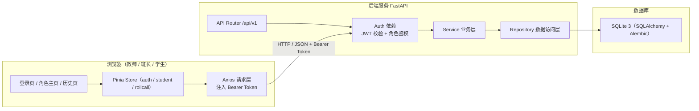
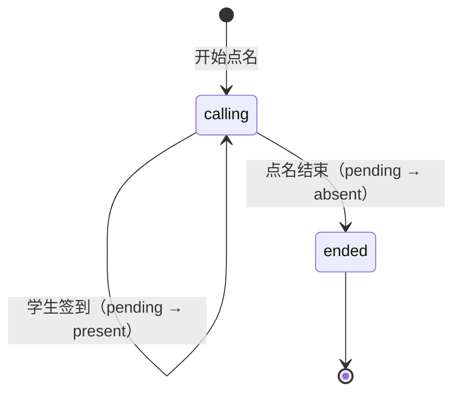

# 教师点名签到系统 · 总体架构

> 文档版本：v1.3（实施阶段，2026-11-06）
> 适用范围：MVP 第一版（含登录、角色权限与多班级）
> 维护方式：三人共同评审；任何接口变更必须先修改本文档第 7 章，再改代码。
>
> **v1.1 变更**：新增登录、JWT 认证与教师/班长/学生三类角色权限；新增 `users` 表与 3 个认证接口；签到改为本人身份校验，前端按角色渲染不同内容。
> **v1.1.1 修复**：#3 班长签到入口与学生统计口径；#4 学号/初始密码长度、SQLite 模糊查询、`checked_at` 三态约束、学号字符集。学号统一为 6–32 位，新增错误码 `40004`。
> **v1.1.2 澄清**：#5 明确 MVP 为单课堂（专业/班级/课程管理登记 P2）；学生历史列表不新增 `my_status`/`my_checked_at`，本人签到时间从详情 `Record.checked_at` 获取；视觉基线以 `frontend/src/styles/main.css` 为准，文档不作为逐像素验收依据。
> **v1.2 实施**：数据库层落地为 SQLite + SQLAlchemy 2.0 + Alembic；`GET /students` 增加 `include_inactive`；`users` 增加内部字段 `token_version`。
> **v1.3 范围变更**：按用户要求引入**多班级**。新增 `classes` 表、`classes` 接口与 `class_id` 字段；教师可跨班，班长/学生仅本班；原“单课堂”边界作废，专业/课程管理仍为 P2。

---

## 1. 项目概述

### 1.1 背景

课堂点名长期依赖纸质名单或口头应答，存在效率低、记录难统计、缺勤追溯困难等问题。本项目提供一个轻量的 Web 应用：教师维护学生名单，一键发起点名；学生在同一页面完成签到；系统自动记录签到与缺勤，支持课后查询。

### 1.2 目标

- 用户登录后，系统按教师、班长、学生三种角色呈现不同页面与操作权限。
- 教师可在浏览器中完成：添加学生、开始点名、结束点名、查看签到与缺勤记录。
- 班长可协助开始/结束点名、查看全班记录，但不可增删学生。
- 学生可查看当前点名、完成本人签到、查看自己的签到与缺勤记录。
- 点名结束后，未签到学生自动进入缺勤记录。
- 页面简洁、美观、移动端可用。
- 三人可并行开发，前后端与数据库契约完全一致。

### 1.3 范围

**MVP 必须实现**

| 编号 | 能力 | 说明 |
| --- | --- | --- |
| F0 | 登录与角色权限 | 用户名/密码登录，JWT 认证；教师/班长/学生三种角色看到不同内容 |
| F1 | 班级管理 | 教师创建/查看/停用班级；学生与点名场次归属一个班级 |
| F2 | 学生名单管理 | 在指定班级下添加学生（姓名、学号、角色）、查看名单、删除学生 |
| F3 | 开始点名 | 选择班级，基于该班在册名单创建一次点名场次，按学号顺序点名 |
| F4 | 学生签到 | 点名进行中，学生点击"签到"，幂等校验防重复 |
| F5 | 结束点名 | 结束场次，未签到学生自动记为缺勤 |
| F6 | 签到记录 | 展示姓名、角色、学号、签到时间 |
| F7 | 缺勤记录 | 展示本次缺勤学生姓名、角色、学号 |
| F8 | 历史场次 | 按班级查看历史点名场次的统计与明细（P1，接口预留） |

**明确不做（后续版本）**

- 多教师隔离、多租户、学校统一身份认证（SSO）。
- 专业/课程管理（P2）；班级管理已纳入 MVP。
- 一个学生跨多个班级（MVP 为**一个学生属于一个班**；跨班选课登记 P2）。
- 学生自助注册、找回密码、邮箱/短信验证（MVP 账号由教师添加学生时自动开通）。
- 人脸识别、定位签到、二维码签到。
- 课程表、成绩管理。
- 实时多人推送（MVP 采用前端轮询 + 手动刷新）。

---

## 2. 技术选型

| 层 | 技术 | 版本建议 | 选型理由 |
| --- | --- | --- | --- |
| 前端 | Vue 3 + Vite + TypeScript | Vue 3.5 / Vite 6 | 组合式 API 上手快，构建快，适合三人小团队 |
| UI | Element Plus | 2.x | 表格、表单、按钮、消息组件齐全，风格简洁 |
| 状态 | Pinia | 2.x | 轻量，适合管理名单、场次、记录三类状态 |
| 路由 | Vue Router | 4.x | 主页面与历史页切换 |
| 请求 | Axios | 1.x | 统一封装拦截器、Token 注入与错误提示 |
| 认证 | JWT（HS256）+ bcrypt | PyJWT 2.x / bcrypt 4.x | 无状态登录，适合课堂单实例；bcrypt 存密码哈希 |
| 后端 | Python 3.12 + FastAPI | FastAPI 0.115+ | 自动生成 OpenAPI，Pydantic 校验强，开发效率高 |
| ORM | SQLAlchemy 2.0 | 2.0+ | 模型与 Repository 统一数据访问 |
| 迁移 | Alembic | 1.13+ | 版本化建库与结构变更 |
| 数据库 | SQLite 3 | 3.46+ | MVP 单文件、零配置 |
| 部署 | 本地启动；Docker Compose 可选 | — | 开发/演示优先 |
| 测试 | Pytest + httpx；Vitest | — | 后端接口测试、前端组件测试 |

> 技术选型在第一次评审通过后冻结，避免并行开发期间更换栈造成契约漂移。

---

## 3. 系统架构



### 3.1 分层职责

- **前端**：只负责展示与交互，不实现点名/缺勤判定规则；根据登录返回的角色渲染不同页面；所有状态以接口返回为准。
- **后端**：唯一业务规则实现方，负责认证、角色鉴权、校验、事务、状态流转、统计。
- **数据库**：只存数据，通过唯一约束与外键保障一致性；不写业务触发器。

### 3.2 关键设计决策

1. **按角色渲染，而非共用一套操作**：登录后根据 `user.role` 渲染教师/班长/学生视图；教师与班长共用课堂管理页，学生使用个人签到页。
2. **场次（Session）模型**：每次"开始点名"生成一个场次，签到记录挂在场次下，历史可追溯。
3. **记录表统一承载签到与缺勤**：`attendance_records.status` 取值 `pending / present / absent`，结束时将 `pending` 批量置为 `absent`，避免两套表不一致。
4. **名单快照**：记录中冗余 `student_no / student_name / role`，学生信息后续变更不影响历史记录。
5. **顺序点名由服务端固化**：创建场次时为每名学生写入 `order_no`，前端只按该顺序轮播高亮，保证刷新后顺序不变。
6. **幂等签到**：数据库唯一约束 `(session_id, student_id)` + 服务层状态校验，重复点击返回明确错误，不产生重复记录。
7. **认证与权限分离**：JWT 只证明"你是谁"，服务层 `require_roles` 决定"你能做什么"；签到不再信任前端传入的 `student_id`，一律取当前登录用户绑定关系。
8. **初始密码强制修改**：学生账号由添加学生时自动开通，`must_change_password = true`，未改密前只能访问 `/auth/me` 与 `/auth/change-password`。

---

## 4. 目录结构（规划）

```text
Teacher's-treasure/
├── docs/
│   ├── 总体架构.md          # 本文档（接口唯一真源）
│   ├── 前端.md
│   ├── 后端.md
│   └── 数据库.md
├── frontend/                # 成员 A：Vue 3 应用
│   ├── src/
│   │   ├── api/
│   │   ├── components/
│   │   ├── stores/
│   │   ├── views/
│   │   ├── types/
│   │   └── styles/
│   └── ...
├── backend/                 # 成员 B：FastAPI 应用
│   ├── app/
│   │   ├── api/v1/
│   │   ├── services/
│   │   ├── repositories/
│   │   ├── models/
│   │   ├── schemas/
│   │   └── core/
│   └── tests/
├── database/                # SQLite + SQLAlchemy + Alembic（已实现）
│   ├── models.py
│   ├── repositories/
│   ├── migrations/
│   └── seeds/
├── docker-compose.yml       # 成员 C 负责，成员 A/B 配合
├── README.md
├── LICENSE
└── .gitignore
```

> 本阶段仅产出设计文档，不生成上述源码文件。

---

## 5. 核心业务规则

### 5.1 角色与权限

系统存在**两层角色**，不要混淆：

| 概念 | 字段 | 取值 | 用途 |
| --- | --- | --- | --- |
| 名单角色 | `students.role` | `学生` / `班长` / `教师`（中文） | 签到记录展示的快照标签 |
| 系统角色 | `users.role` | `student` / `monitor` / `teacher`（英文） | 登录后决定页面与接口权限 |

**账号来源**

- 教师账号：由数据库种子/初始化脚本创建（`username` 自定义），不通过页面注册。
- 学生/班长账号：教师添加学生时自动开通。`username = student_no`，初始密码由教师指定或默认等于学号，`must_change_password = true`。
- 名单角色映射：`学生 → student`，`班长 → monitor`；`教师` 仅保留为历史展示值，MVP 添加表单不提供该选项。
- 学生账号通过 `users.student_id` 绑定 `students.id`；教师账号 `student_id` 为空。

**权限矩阵**

| 能力 | 教师 teacher | 班长 monitor | 学生 student |
| --- | --- | --- | --- |
| 查看/管理班级 | ✓ 全部，可创建/停用 | ✓ 仅本班 | ✓ 仅本班 |
| 查看学生名单 | ✓ 全部班级 | ✓ 本班只读 | ✗ |
| 添加/删除学生 | ✓ 任意班级 | ✗ | ✗ |
| 开始/结束点名 | ✓ 任意班级 | ✓ 仅本班 | ✗ |
| 查看签到/缺勤 | ✓ 全部班级 | ✓ 本班 | ✗（仅本人） |
| 本人签到 | ✗（教师账号不绑定学生） | ✓ | ✓ |
| 查看历史场次 | ✓ 全部 | ✓ 本班 | ✓ 仅本人记录 |
| 修改本人密码 | ✓ | ✓ | ✓（首次登录强制） |

**班级范围规则**

- 班级由教师创建/停用；`classes.code` 全局唯一，停用班级不可再添加学生或开始点名。
- 教师可选择任意在用班级；班长/学生的班级固定为 `users.student_id → students.class_id`。
- 班长/学生请求其他班级数据一律返回 `40301`；场次详情跨班统一返回 `40402`，避免枚举。
- 一个学生只属于一个班级；`students.student_no` 全局唯一。
- 签到记录展示的"角色"为场次创建时的 `students.role` 快照值，与系统角色无关。

### 5.2 场次状态机



- `calling`：点名进行中，允许签到。
- `ended`：已结束，禁止签到；所有 `pending` 已转为 `absent`。
- 已结束场次不可重新开始；再次点名将创建新场次。

### 5.3 开始点名规则

1. 教师必须指定 `class_id`；班长不传或传其他班级时强制使用本人班级（其他班级返回 `40301`）。
2. 班级必须存在且 `active = true`，否则 `40403`。
3. 读取该班级 `students` 中 `active = true` 的学生；若为空，返回 HTTP 409 + `code=40905`，提示"该班级没有在册学生"。
4. 创建场次：写入 `class_id`、`status = calling`、`started_at = 当前时间`。
5. 按 `order_by` 排序（默认 `student_no` 升序），为每名学生插入一条 `attendance_records`，`status = pending`，`order_no` 从 1 递增。
6. 返回场次详情（含全部记录），前端据此开始轮播。

### 5.4 签到规则

1. 场次必须存在且为 `calling`，否则 `40402 / 40903`。
2. 当前登录用户必须绑定学生（`user.student_id` 非空）且该学生所属班级等于场次 `class_id`，否则 `40301 / 40904`；教师账号或无绑定账号返回 `40301`。
3. 记录状态必须为 `pending`；若已 `present` 返回 `40902`（重复签到）。
4. 更新 `status = present`、`checked_at = 服务器当前时间`。
5. 签到时间与签到学生均以服务端身份为准，前端不得传入 `student_id` 或时间。
6. `must_change_password = true` 的用户必须先完成改密，否则签到等业务接口返回 `40302`。

### 5.5 结束点名规则

1. 场次必须为 `calling`，否则 `40903`。
2. 将该场次所有 `pending` 记录改为 `absent`，`checked_at = 结束时间`（缺勤时间定义为结束时刻，前端缺勤表可显示"未签到"）。
3. 场次 `status = ended`，`ended_at = 当前时间`。
4. 在同一个数据库事务中完成，保证统计一致。
5. 返回场次统计与两类记录。

### 5.6 统计口径

- `total_count`：场次记录总数（创建时的在册学生数）。
- `present_count`：`status = present` 的数量。
- `absent_count`：`status = absent` 的数量。
- `pending_count`：`status = pending` 的数量。
- 统计由后端实时聚合查询返回，不依赖前端计算。

**按请求者角色与班级裁剪**

| 请求者 | 可见场次 | 统计口径 |
| --- | --- | --- |
| 教师 | 全部班级的场次 | 所请求班级的全班统计 |
| 班长 | 仅本班场次 | 本班：`total_count` 为场次总人数 |
| 学生 | 仅本人参与过的本班场次 | 本人：`total_count = 1`，`present/absent/pending_count` 为 0 或 1 |

- 场次归属单一班级；教师可按 `class_id` 筛选，班长/学生由服务端强制本班。
- 学生请求未参与的场次、跨班场次，统一返回 `40402`（不暴露场次是否存在），防止遍历 ID 读取标题与统计。
- 学生页面只展示本人状态；教师/班长按班级查看全班统计。

---

## 6. 时间与时区约定

- 数据库存储 UTC 时间；后端在响应中统一输出 ISO 8601 带时区偏移，例如 `2026-11-05T22:30:00+08:00`。
- 前端展示时转换为浏览器本地时区，格式 `YYYY-MM-DD HH:mm:ss`。
- `started_at`、`ended_at`、`checked_at` 均由服务端生成。

---

## 7. 统一接口契约（唯一真源）

> **本章是前端、后端、数据库三方共同遵守的唯一契约。**
> 任何字段、路径、错误码变更必须先修改本章，并在 PR 中同时 @ 前端与后端负责人。
> 后端 FastAPI 自动生成的 OpenAPI 必须与本章一致；前端类型定义必须逐字段对应。

### 7.1 通用约定

| 项 | 约定 |
| --- | --- |
| Base URL | `/api/v1` |
| 数据格式 | `application/json; charset=utf-8` |
| 字段命名 | **全部使用 `snake_case`**（与数据库列名一致，减少映射错误） |
| 成功响应 | `{ "code": 0, "message": "success", "data": <资源> }` |
| 失败响应 | `{ "code": <业务码>, "message": "<中文提示>", "data": null }` |
| HTTP 状态码 | 成功 200/201；参数错误 400/422；未找到 404；冲突 409；服务异常 500 |
| 时间格式 | ISO 8601，带时区偏移 |
| 分页参数 | `page`（默认 1）、`page_size`（默认 20，最大 100） |
| 分页响应 | `{ "items": [...], "total": 0, "page": 1, "page_size": 20 }` |
| 字符集 | UTF-8；姓名 1–32 字符；学号 6–32 字符，正则 `^[A-Za-z0-9_-]+$` |
| 认证 | 除 `/health`、`/auth/login` 外，所有接口必须携带 `Authorization: Bearer <access_token>` |
| Token 有效期 | 8 小时（480 分钟）；过期返回 `40103`，前端跳转登录页 |
| CORS | 开发环境允许 `http://localhost:5173`；允许 `Authorization` 请求头 |

### 7.2 业务错误码

| code | HTTP | 含义 | 前端处理 |
| --- | --- | --- | --- |
| 0 | 200/201 | 成功 | 正常渲染 |
| 40001 | 400/422 | 参数校验失败 | 表单字段标红 + message |
| 40002 | 400 | 初始密码不符合策略（6–32 字符） | 初始密码输入框提示 |
| 40003 | 400 | 旧密码不正确 | 旧密码输入框提示 |
| 40004 | 400 | 新密码不符合策略（8–64 位，含字母和数字） | 新密码输入框提示 |
| 40101 | 401 | 未登录、Token 缺失或无效 | 清除本地登录态，跳转 `/login` |
| 40102 | 401 | 用户名或密码错误 | 登录表单通用错误提示 |
| 40103 | 401 | 登录已过期 | 清除登录态，跳转 `/login` |
| 40301 | 403 | 角色权限不足 | 提示"无权执行该操作" |
| 40302 | 403 | 需先修改初始密码 | 跳转 `/change-password` |
| 40401 | 404 | 学生不存在 | 刷新名单 |
| 40402 | 404 | 点名场次不存在或无权查看 | 返回主页面并刷新 |
| 40403 | 404 | 班级不存在或已停用 | 刷新班级列表 |
| 40901 | 409 | 学号已存在 | 学号输入框提示 |
| 40902 | 409 | 该学生已签到 | 按钮置为"已签到" |
| 40903 | 409 | 点名已结束 | 禁用签到并刷新场次 |
| 40904 | 409 | 学生不在该场次 / 班级不匹配 | 刷新场次详情 |
| 40905 | 409 | 该班级没有在册学生，无法开始点名 | 提示先添加学生 |
| 40906 | 409 | 账号已存在（用户名冲突） | 提示更换用户名或联系教师 |
| 40907 | 409 | 班级编号已存在 | 班级编号输入框提示 |
| 40908 | 409 | 班级仍有在册学生，无法停用 | 提示先转出/删除学生 |
| 50000 | 500 | 服务器内部错误 | 通用错误提示，允许重试 |

### 7.3 数据结构定义

#### User（登录用户）

| 字段 | 类型 | 可空 | 说明 |
| --- | --- | --- | --- |
| `id` | integer | 否 | 主键 |
| `username` | string | 否 | 登录名，全局唯一；学生账号默认等于学号 |
| `role` | string | 否 | 系统角色：`teacher` / `monitor` / `student` |
| `display_name` | string | 否 | 显示名称（学生为姓名，教师为自定义名称） |
| `student_id` | integer | 是 | 绑定的学生 ID；教师账号为 `null` |
| `class_id` | integer | 是 | 学生/班长所属班级 ID（由绑定学生推导）；教师为 `null` |
| `must_change_password` | boolean | 否 | 是否必须修改初始密码 |
| `active` | boolean | 否 | 账号是否启用；学生软删除时同步禁用 |
| `created_at` | string(datetime) | 否 | 创建时间 |
| `last_login_at` | string(datetime) | 是 | 最近登录时间 |

#### LoginResponse（登录响应）

| 字段 | 类型 | 说明 |
| --- | --- | --- |
| `access_token` | string | JWT Token |
| `token_type` | string | 固定 `bearer` |
| `expires_in` | integer | 有效期秒数，默认 `28800` |
| `user` | User | 当前用户信息 |

#### Class（班级）

| 字段 | 类型 | 可空 | 说明 |
| --- | --- | --- | --- |
| `id` | integer | 否 | 主键 |
| `name` | string | 否 | 班级名称，1–32 字符 |
| `code` | string | 否 | 班级编号，1–32 字符，全局唯一 |
| `active` | boolean | 否 | 是否在用；停用后不可添加学生/开始点名 |
| `created_at` | string(datetime) | 否 | 创建时间 |

> `Student` / `Session` / `User` 只返回 `class_id`；班级名称由前端通过 `GET /classes` 映射，避免重复字段。

#### Student（学生）

| 字段 | 类型 | 可空 | 说明 |
| --- | --- | --- | --- |
| `id` | integer | 否 | 主键 |
| `class_id` | integer | 否 | 所属班级 ID |
| `student_no` | string | 否 | 学号，全局唯一 |
| `name` | string | 否 | 姓名 |
| `role` | string | 否 | `学生`/`班长`/`教师`，默认 `学生` |
| `active` | boolean | 否 | 是否在册，默认 `true` |
| `created_at` | string(datetime) | 否 | 创建时间 |

#### Session（点名场次）

| 字段 | 类型 | 可空 | 说明 |
| --- | --- | --- | --- |
| `id` | integer | 否 | 主键 |
| `class_id` | integer | 否 | 所属班级 ID |
| `title` | string | 否 | 场次标题，默认 `YYYY-MM-DD 课堂点名` |
| `status` | string | 否 | `calling` / `ended` |
| `order_by` | string | 否 | `student_no` / `name` / `id`，默认 `student_no` |
| `started_at` | string(datetime) | 否 | 开始时间 |
| `ended_at` | string(datetime) | 是 | 结束时间，未结束为 `null` |
| `total_count` | integer | 否 | 总人数；学生视角为本人维度，固定 1 |
| `present_count` | integer | 否 | 已签到人数；学生视角为 0/1 |
| `absent_count` | integer | 否 | 缺勤人数；学生视角为 0/1 |
| `pending_count` | integer | 否 | 待签到人数；学生视角为 0/1 |

#### Record（签到/缺勤记录）

| 字段 | 类型 | 可空 | 说明 |
| --- | --- | --- | --- |
| `id` | integer | 否 | 主键 |
| `session_id` | integer | 否 | 场次 ID |
| `student_id` | integer | 否 | 学生 ID |
| `student_no` | string | 否 | 学号快照 |
| `student_name` | string | 否 | 姓名快照 |
| `role` | string | 否 | 角色快照 |
| `order_no` | integer | 否 | 点名顺序，从 1 开始 |
| `status` | string | 否 | `pending` / `present` / `absent` |
| `checked_at` | string(datetime) | 是 | 签到时间；缺勤时为结束时间；pending 为 `null` |

#### SessionDetail（场次详情）

```json
{
  "session": { "…Session 字段…" },
  "records": [ { "…Record 字段…" } ]
}
```

`records` 按 `order_no` 升序排列；前端按 `status` 过滤出签到记录与缺勤记录。

> **学生历史字段口径（#5）**：学生视角的 `Session` 统计为本人维度，**不新增** `my_status` / `my_checked_at` 字段。学生列表可用 `present_count = 1` 判断"已签到"、`absent_count = 1` 判断"缺勤"；本人签到/缺勤时间通过详情中的 `Record.checked_at` 获取，列表不展示"我的时间"。

### 7.4 接口总表（前后端共同遵守）

| 序号 | 方法 | 路径 | 用途 | 允许角色 |
| --- | --- | --- | --- | --- |
| 1 | POST | `/api/v1/auth/login` | 登录，获取 Token | 公开 |
| 2 | GET | `/api/v1/auth/me` | 获取当前登录用户 | 全部已登录 |
| 3 | POST | `/api/v1/auth/change-password` | 修改本人密码 | 全部已登录 |
| 4 | GET | `/api/v1/health` | 健康检查 | 公开 |
| 5 | GET | `/api/v1/students` | 学生列表 | 教师、班长 |
| 6 | POST | `/api/v1/students` | 添加学生并自动开通账号 | 教师 |
| 7 | DELETE | `/api/v1/students/{student_id}` | 删除学生（软删除并禁用账号） | 教师 |
| 8 | POST | `/api/v1/rollcalls` | 开始点名，创建场次 | 教师、班长 |
| 9 | GET | `/api/v1/rollcalls` | 历史/当前场次分页列表（学生仅本人参与，统计为本人维度） | 全部已登录 |
| 10 | GET | `/api/v1/rollcalls/{session_id}` | 场次详情 + 记录（学生仅本人记录与统计，未参与返回 40402） | 全部已登录 |
| 11 | POST | `/api/v1/rollcalls/{session_id}/checkin` | 本人签到 | 学生、班长 |
| 12 | POST | `/api/v1/rollcalls/{session_id}/end` | 结束点名并生成缺勤 | 教师、班长 |
| 13 | GET | `/api/v1/classes` | 班级列表（教师全部；班长/学生本班） | 全部已登录 |
| 14 | POST | `/api/v1/classes` | 创建班级 | 教师 |
| 15 | DELETE | `/api/v1/classes/{class_id}` | 停用班级（软删除） | 教师 |

**接口明细（摘要，完整请求/响应示例见《后端.md》第 4 章）**

| 接口 | 请求关键字段 | 成功 `data` |
| --- | --- | --- |
| `POST /auth/login` | `username`, `password` | `LoginResponse` |
| `GET /auth/me` | 无（Token） | `User` |
| `POST /auth/change-password` | `old_password`, `new_password` | `{ "changed": true }` |
| `POST /students` | `class_id`, `student_no`, `name`, `role?`, `initial_password?`, `create_account?` | `Student`，HTTP 201 |
| `GET /students` | `class_id?`, `keyword?`, `active?`（默认 true）, `include_inactive?`（默认 false） | `Student[]`（不分页） |
| `DELETE /students/{id}` | 路径参数 | `{ "id": 1, "deleted": true }` |
| `POST /rollcalls` | `class_id`, `title?`, `order_by?` | `SessionDetail`，HTTP 201 |
| `GET /rollcalls` | `class_id?`, `page`, `page_size`, `status?` | 分页 `Session[]` |
| `GET /rollcalls/{id}` | 路径参数 | `SessionDetail`（学生仅本人记录） |
| `POST /rollcalls/{id}/checkin` | 无请求体（身份取自 Token） | `Record`（`status=present`） |
| `POST /rollcalls/{id}/end` | 无 | `SessionDetail`（含缺勤） |
| `GET /classes` | `active?`, `include_inactive?` | `Class[]` |
| `POST /classes` | `name`, `code` | `Class`，HTTP 201 |
| `DELETE /classes/{id}` | 路径参数 | `{ "id": 1, "deleted": true }` |

> 学生历史列表返回 `Session` 的本人维度统计，不返回 `my_status` / `my_checked_at`；列表据 `present_count` / `absent_count` 展示本人状态，签到时间进入场次详情查看 `Record.checked_at`。

### 7.5 契约一致性保障

1. **文档优先**：先改本章，再改 OpenAPI，再改前端类型。
2. **OpenAPI 校验**：后端 CI 导出 `openapi.json`；前端可用 `openapi-typescript` 生成类型，禁止手写与文档不一致的类型。
3. **联调检查清单**：每个 PR 必须附"受影响接口"列表；三人每周一次接口对账。
4. **禁止私自扩展**：不得在响应中随意增加字段；新增字段必须可空并提供默认值，保持向后兼容。
5. **错误码唯一**：新增错误码必须登记到 7.2，禁止复用。

---

## 8. 三人分工

| 成员 | 负责模块 | 主要交付物 | 依赖 |
| --- | --- | --- | --- |
| 成员 A | 前端 | 登录页、改密页、路由守卫、角色视图、班级选择/管理、页面组件、状态管理、接口封装、样式、前端测试 | 依赖第 7 章契约与后端可运行服务 |
| 成员 B | 后端 | 认证与 JWT、角色与班级鉴权、15 个业务 API、业务规则、事务、OpenAPI、后端测试 | 依赖第 7 章契约与数据库 DDL |
| 成员 C | 数据库 / 部署 | SQLite DDL、SQLAlchemy 模型、班级/账号迁移、Repository、种子账号、约束测试 | 依赖第 7 章数据结构 |
| 全体 | 总体架构 | 本文档评审、接口对账、联调、发布 | — |

### 8.1 并行开发顺序

1. 三人共同评审并通过本设计（冻结 v1.3 契约）。
2. 成员 C 先提交 SQLite 模型、班级/账号迁移与教师种子账号（已完成）。
3. 成员 B 实现认证、角色/班级鉴权与 15 个业务 API，并产出 `openapi.json`。
4. 成员 A 按契约搭建登录页、班级选择/管理与角色视图，可先用 Mock 数据（Mock 必须严格遵循第 7 章）。
5. 三方联调，执行验收清单，修复后发布 v1.3。

### 8.2 Git 协作规范

- 主分支：`main`，保护分支，禁止直接 push。
- 功能分支：`feature/frontend-<主题>`、`feature/backend-<主题>`、`feature/database-<主题>`。
- 修复分支：`fix/<主题>`。
- 提交信息：`feat(frontend): 添加学生表单`、`fix(backend): 修复重复签到判断`、`docs: 更新接口契约`。
- PR 要求：至少 1 人 review；涉及接口的 PR 必须 2 人 review；CI 通过后合并（Squash Merge）。
- 接口变更流程：修改 `docs/总体架构.md` → 三人在 PR 中确认 → 后端合并 → 前端更新类型。

---

## 9. 非功能需求

| 类别 | 要求 |
| --- | --- |
| 性能 | 单场次 200 人以内；列表接口 P95 < 300ms；签到接口 P95 < 200ms |
| 并发 | 签到使用行级/唯一约束防重；结束点名使用事务，避免统计错乱 |
| 可用性 | 页面在 Chrome/Edge/Safari 最近两个大版本可用；移动端宽度 ≥ 360px |
| 可访问性 | 按钮有明确文本；错误提示不只依赖颜色；键盘可完成主要操作 |
| 安全 | 参数白名单校验；防 SQL 注入（ORM 参数化）；密码使用 bcrypt 哈希存储；JWT 密钥仅通过环境变量注入；生产环境限制 CORS；不在日志中打印密码、Token 与完整个人信息 |
| 认证 | JWT 有效期 8 小时；登出由前端清除 Token；修改密码后要求重新登录；登录失败统一提示，不暴露账号是否存在 |
| 可维护性 | 前后端均通过 lint 与测试；接口文档自动生成；数据库变更必须走迁移文件 |
| 可观测性 | 后端结构化日志记录请求 ID、路径、状态码、耗时；健康检查接口 |

---

## 10. 里程碑（按交付顺序，不承诺具体日期）

| 阶段 | 内容 | 出口标准 |
| --- | --- | --- |
| M0 设计 | 四份文档评审通过 | 三人确认无异议，契约冻结 |
| M1 数据层 | SQLite DDL、SQLAlchemy 模型、Alembic 0001–0007、种子账号 | 本地可建库，班级/学生/场次约束生效，教师账号可登录（已完成） |
| M2 后端 | 认证 + 15 个接口 + 测试 | OpenAPI 与第 7 章一致，接口/角色/班级权限测试全绿 |
| M3 前端 | 登录页、班级选择与管理、角色视图、主页面、历史页 | 三种角色登录后班级范围正确，主流程可完整操作 |
| M4 联调 | 端到端验收 | 验收清单全部通过 |
| M5 发布 | README、部署说明、v1.3 Tag | 开源仓库可一键启动 |

---

## 11. 验收清单（端到端）

1. 未登录访问 `/` 自动跳转 `/login`；输入正确账号密码后进入对应角色主页。
2. 错误密码提示"用户名或密码错误"，不暴露账号是否存在。
3. 教师登录后可创建/切换班级，在任意班级下增删学生、点名并查看该班签到/缺勤记录。
4. 班长登录后只能看到本班名单与本班记录，看不到添加/删除学生按钮；跨班请求返回 `40301`；可在"我的签到"卡片完成本人签到。
5. 学生登录后只看到本班的"我的签到"与"我的记录"，看不到名单管理和点名控制；跨班场次返回 `40402`；接口统计为本人维度。
6. 学生首次登录（`must_change_password=true`）被强制跳转改密页；未改密前调用业务接口返回 `40302`。
7. 空班级点击"开始点名"，提示"该班级没有在册学生"，不创建场次。
8. 在指定班级输入姓名/学号（学号 6–32 位，1–5 位被拒绝），点击"添加学生"，列表立即出现该学生；重复学号给出明确提示；账号自动开通且初始密码规则正确。
9. 添加 3 名学生后开始点名，按钮变为"点名结束"，学生按学号顺序高亮。
10. 学生点击"签到"后，签到记录区出现姓名、角色、学号、签到时间；重复点击不会产生第二条记录。
11. 结束点名后，未签到学生出现在缺勤记录区；场次统计满足 `present + absent = total`。
12. 结束后再点签到，提示"点名已结束"，不产生记录。
13. 刷新页面后，进行中的场次能恢复；历史页可按班级查看已结束场次明细；学生只能看到自己的记录。
14. 移动端（360px）下表单、名单、记录区无横向滚动，按钮可点击。
15. 学生历史列表只展示本人维度统计，不显示"我的时间"；本人签到时间在详情中查看。
16. 教师创建两个班级并分别添加学生；名单、场次、历史均按班级隔离。
17. 班长/学生访问其他班级的学生、场次时返回 `40301` 或 `40402`，不泄露数据。
18. 班级仍有在册学生时停用返回 `40908`；停用后的班级不可再添加学生或开始点名。
19. 学号在全局唯一，不同班级不能重复添加同一学号。
20. 前后端联调时，所有字段名与第 7 章完全一致，无 camelCase/snake_case 混用。