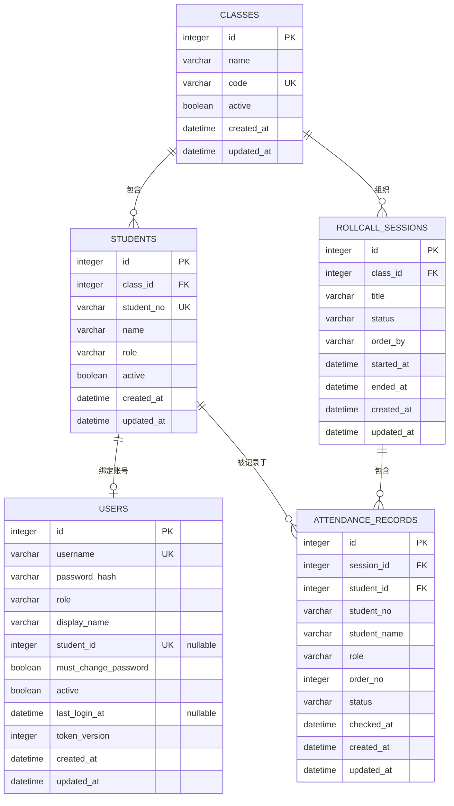

# 教师点名签到系统 · 数据库设计

> 文档版本：v1.3（实施阶段，2026-11-06）
> 负责人：成员 C
> 契约来源：《总体架构.md》第 7 章。表名、字段名、枚举值必须与后端 API、前端字段完全一致。
>
> **v1.1 变更**：新增 `users` 登录账号表（JWT 认证、角色权限）；与 `students` 一对一绑定；新增账号 Repository 与教师种子账号说明。
> **v1.1.1 修复**：#4 学号统一 6–32 位、SQLite 模糊查询改用 `LOWER LIKE`、`checked_at` 约束覆盖 pending/present/absent 三态；#3 学生统计按本人维度聚合。
> **v1.2 实施**：数据库已落地为 SQLite + SQLAlchemy 2.0 + Alembic；权威 DDL 见 `database/schema.sql`；`users` 增加内部字段 `token_version`；学生查询支持 `include_inactive`。
> **v1.3 多班级**：新增 `classes` 表；`students.class_id` 与 `rollcall_sessions.class_id` 非空外键；迁移 `0006/0007` 回填默认班级；Repository 支持班级过滤。

---

## 1. 设计原则

1. **字段即契约**：数据库列名与 API JSON 字段名一致（`snake_case`），后端不做重命名映射。
2. **历史不可变**：签到记录保存学生姓名、学号、角色快照，学生信息变更不影响历史。
3. **单一事实来源**：签到与缺勤共用 `attendance_records`，用 `status` 区分，避免两表不一致。
4. **约束下沉**：唯一性、外键、枚举值用数据库约束兜底，应用层校验用于友好提示。
5. **可迁移**：MVP 使用 SQLite，通过 SQLAlchemy 2.0 + Alembic 管理，禁止手工改表结构。

---

## 2. 实体关系



**关系说明**

- 一个班级包含多个学生与多个点名场次（1:N）；一个学生只属于一个班级。
- 一个学生可出现在多个场次的记录中（1:N）。
- 一个场次包含多条记录（1:N）。
- 一个学生至多绑定一个登录账号（1:0..1）；教师账号 `student_id` 为 NULL，不绑定学生。
- `(session_id, student_id)` 唯一，保证同一场次同一学生只有一条记录。
- `student_id` 外键指向学生，但记录同时保存快照；学生采用软删除，不破坏外键。
- 删除学生为软删除，同时将绑定账号置为禁用，不删除账号与历史记录。
- 班级停用为软删除；仍有在册学生的班级不允许停用（应用层校验 + 外键 RESTRICT）。

---

## 3. 表结构

### 3.1 `classes`（班级）

| 列 | 类型（SQLite） | 可空 | 默认 | 说明 |
| --- | --- | --- | --- | --- |
| `id` | `INTEGER` | 否 | 自增 | 主键 |
| `name` | `VARCHAR(32)` | 否 | — | 班级名称，1–32 字符 |
| `code` | `VARCHAR(32)` | 否 | — | 班级编号，1–32 字符，全局唯一 |
| `active` | `BOOLEAN` | 否 | `TRUE` | 是否在用；停用为软删除 |
| `created_at` | `DATETIME` | 否 | `CURRENT_TIMESTAMP` | 创建时间 |
| `updated_at` | `DATETIME` | 否 | `CURRENT_TIMESTAMP` | 更新时间 |

**约束**

- `PRIMARY KEY (id)`
- `UNIQUE (code)`：班级编号全局唯一
- `CHECK (length(name) BETWEEN 1 AND 32)`
- `CHECK (length(code) BETWEEN 1 AND 32)`

**索引**

- `idx_classes_active_code (active, code)`：班级列表与筛选。

---

### 3.2 `students`（学生名单）

| 列 | 类型（SQLite） | 可空 | 默认 | 说明 |
| --- | --- | --- | --- | --- |
| `id` | `INTEGER` | 否 | 自增 | 主键 |
| `class_id` | `INTEGER` | 否 | — | 所属班级 ID，外键 |
| `student_no` | `VARCHAR(32)` | 否 | — | 学号，6–32 字符，全局唯一 |
| `name` | `VARCHAR(32)` | 否 | — | 姓名 |
| `role` | `VARCHAR(16)` | 否 | `'学生'` | `学生`/`班长`/`教师` |
| `active` | `BOOLEAN` | 否 | `TRUE` | 是否在册；删除为软删除 |
| `created_at` | `DATETIME` | 否 | `CURRENT_TIMESTAMP` | 创建时间（UTC） |
| `updated_at` | `DATETIME` | 否 | `CURRENT_TIMESTAMP` | 更新时间（UTC） |

**约束**

- `PRIMARY KEY (id)`
- `FOREIGN KEY (class_id) REFERENCES classes(id) ON DELETE RESTRICT`
- `UNIQUE (student_no)`：学号全局唯一，软删除后不可复用（保证历史可追溯）
- `CHECK (role IN ('学生', '班长', '教师'))`
- `CHECK (length(student_no) BETWEEN 6 AND 32)`
- `CHECK (length(name) BETWEEN 1 AND 32)`

**索引**

- `idx_students_active_no (active, student_no)`：默认名单查询与排序。
- `idx_students_class_active_no (class_id, active, student_no)`：按班级筛选/点名。
- 唯一索引已覆盖 `student_no` 精确查找。

---

### 3.3 `rollcall_sessions`（点名场次）

| 列 | 类型 | 可空 | 默认 | 说明 |
| --- | --- | --- | --- | --- |
| `id` | `INTEGER` | 否 | 自增 | 主键 |
| `class_id` | `INTEGER` | 否 | — | 所属班级 ID，外键 |
| `title` | `VARCHAR(64)` | 否 | — | 场次标题 |
| `status` | `VARCHAR(16)` | 否 | `'calling'` | `calling` / `ended` |
| `order_by` | `VARCHAR(16)` | 否 | `'student_no'` | `student_no` / `name` / `id` |
| `started_at` | `DATETIME` | 否 | `CURRENT_TIMESTAMP` | 开始时间 |
| `ended_at` | `DATETIME` | 是 | `NULL` | 结束时间；进行中为 NULL |
| `created_at` | `DATETIME` | 否 | `CURRENT_TIMESTAMP` | 创建时间 |
| `updated_at` | `DATETIME` | 否 | `CURRENT_TIMESTAMP` | 更新时间 |

**约束**

- `PRIMARY KEY (id)`
- `FOREIGN KEY (class_id) REFERENCES classes(id) ON DELETE RESTRICT`
- `CHECK (status IN ('calling', 'ended'))`
- `CHECK (order_by IN ('student_no', 'name', 'id'))`
- `CHECK (length(title) BETWEEN 1 AND 64)`
- `CHECK (ended_at IS NULL OR ended_at >= started_at)`
- `CHECK (status = 'calling' AND ended_at IS NULL) OR (status = 'ended' AND ended_at IS NOT NULL)`

**索引**

- `idx_sessions_started (started_at, id)`：历史列表排序（SQLite 可反向扫描实现倒序）。
- `idx_sessions_status (status)`：按状态过滤。
- `idx_sessions_class_started (class_id, started_at, id)`：按班级查历史。

> 统计字段（总人数/已签到/缺勤/待签到）**不落库**，由后端实时聚合，避免冗余不一致。若后续性能不足，再增加缓存字段并纳入契约变更。

---

### 3.4 `attendance_records`（签到/缺勤记录）

| 列 | 类型 | 可空 | 默认 | 说明 |
| --- | --- | --- | --- | --- |
| `id` | `INTEGER` | 否 | 自增 | 主键 |
| `session_id` | `INTEGER` | 否 | — | 场次 ID，外键 |
| `student_id` | `INTEGER` | 否 | — | 学生 ID，外键 |
| `student_no` | `VARCHAR(32)` | 否 | — | 学号快照（6–32 字符） |
| `student_name` | `VARCHAR(32)` | 否 | — | 姓名快照 |
| `role` | `VARCHAR(16)` | 否 | — | 角色快照 |
| `order_no` | `INTEGER` | 否 | — | 点名顺序，从 1 开始 |
| `status` | `VARCHAR(16)` | 否 | `'pending'` | `pending` / `present` / `absent` |
| `checked_at` | `DATETIME` | 是 | `NULL` | 签到时间；缺勤为结束时间；pending 为 NULL |
| `created_at` | `DATETIME` | 否 | `CURRENT_TIMESTAMP` | 创建时间 |
| `updated_at` | `DATETIME` | 否 | `CURRENT_TIMESTAMP` | 更新时间 |

**约束**

- `PRIMARY KEY (id)`
- `FOREIGN KEY (session_id) REFERENCES rollcall_sessions(id) ON DELETE CASCADE`
- `FOREIGN KEY (student_id) REFERENCES students(id) ON DELETE RESTRICT`
- `UNIQUE (session_id, student_id)`：同一场次同一学生唯一
- `UNIQUE (session_id, order_no)`：同一场次点名顺序唯一
- `CHECK (status IN ('pending', 'present', 'absent'))`
- `CHECK (order_no >= 1)`
- `CHECK ((status = 'pending' AND checked_at IS NULL) OR (status IN ('present', 'absent') AND checked_at IS NOT NULL))`
- `CHECK (length(student_no) BETWEEN 6 AND 32)`
- `CHECK (length(student_name) BETWEEN 1 AND 32)`
- `CHECK (role IN ('学生', '班长', '教师'))`

**索引**

- `idx_records_session_status_order (session_id, status, order_no)`：按状态筛选签到/缺勤、按顺序展示。
- `idx_records_session_order (session_id, order_no)`：场次详情排序。
- `idx_records_student (student_id)`：按学生查历史（P1）。
- 唯一约束 `(session_id, student_id)` 自带索引，签到原子更新可命中。

---

### 3.5 `users`（登录账号）

| 列 | 类型 | 可空 | 默认 | 说明 |
| --- | --- | --- | --- | --- |
| `id` | `INTEGER` | 否 | 自增 | 主键 |
| `username` | `VARCHAR(32)` | 否 | — | 登录名，全局唯一；学生账号默认等于学号 |
| `password_hash` | `VARCHAR(255)` | 否 | — | bcrypt 哈希（60 字符），禁止存明文 |
| `role` | `VARCHAR(16)` | 否 | — | 系统角色：`teacher` / `monitor` / `student` |
| `display_name` | `VARCHAR(32)` | 否 | — | 显示名称（学生为姓名，教师为自定义名称） |
| `student_id` | `INTEGER` | 是 | `NULL` | 绑定学生 ID；教师账号为 NULL |
| `must_change_password` | `BOOLEAN` | 否 | `TRUE` | 是否必须修改初始密码 |
| `active` | `BOOLEAN` | 否 | `TRUE` | 账号是否启用 |
| `last_login_at` | `DATETIME` | 是 | `NULL` | 最近登录时间 |
| `token_version` | `INTEGER` | 否 | `0` | 内部字段；改密时 +1，用于使旧 JWT 失效 |
| `created_at` | `DATETIME` | 否 | `CURRENT_TIMESTAMP` | 创建时间 |
| `updated_at` | `DATETIME` | 否 | `CURRENT_TIMESTAMP` | 更新时间 |

**约束**

- `PRIMARY KEY (id)`
- `UNIQUE (username)`：登录名全局唯一
- `UNIQUE (student_id)`：一个学生最多一个账号；SQLite 允许多个 NULL
- `FOREIGN KEY (student_id) REFERENCES students(id) ON DELETE RESTRICT`
- `CHECK (role IN ('teacher', 'monitor', 'student'))`
- `CHECK ((role = 'teacher' AND student_id IS NULL) OR (role <> 'teacher' AND student_id IS NOT NULL))`
- `CHECK (length(username) BETWEEN 1 AND 32)`
- `CHECK (length(display_name) BETWEEN 1 AND 32)`
- `CHECK (length(password_hash) >= 20)`：防止误存明文
- `CHECK (token_version >= 0)`

**索引**

- `idx_users_role (role)`：按角色统计/筛选（P1）。
- `idx_users_active (active)`：登录时过滤禁用账号。
- 唯一索引 `username`、`student_id` 已覆盖登录与绑定查询。

> 教师账号由种子脚本创建（`student_id = NULL`）；学生/班长账号在添加学生时由后端同一事务创建，角色映射 `学生 → student`、`班长 → monitor`。

---

## 4. 枚举与状态字典

| 枚举 | 取值 | 含义 |
| --- | --- | --- |
| `students.role` | `学生` / `班长` / `教师` | 名单展示角色（签到快照） |
| `users.role` | `teacher` / `monitor` / `student` | 系统权限角色 |
| `rollcall_sessions.status` | `calling` / `ended` | 点名进行中 / 已结束 |
| `rollcall_sessions.order_by` | `student_no` / `name` / `id` | 点名顺序依据 |
| `attendance_records.status` | `pending` / `present` / `absent` | 待签到 / 已签到 / 缺勤 |

**状态流转（数据库视角）**

```text
创建场次：  (无) ──插入──> pending
签到：      pending ──UPDATE──> present（checked_at = 签到时间）
结束点名：  pending ──UPDATE──> absent（checked_at = 结束时间）
已结束场次：present / absent 不再变化（应用层禁止）
```

---

## 5. DDL（SQLite 方言，权威实现见 database/schema.sql）

> 以下 DDL 与 `database/schema.sql`、Alembic `0001-0007` 保持一致，已可实际执行。

```sql
CREATE TABLE classes (
    id          INTEGER NOT NULL PRIMARY KEY,
    name        VARCHAR(32) NOT NULL,
    code        VARCHAR(32) NOT NULL,
    active      BOOLEAN NOT NULL DEFAULT TRUE,
    created_at  DATETIME NOT NULL DEFAULT CURRENT_TIMESTAMP,
    updated_at  DATETIME NOT NULL DEFAULT CURRENT_TIMESTAMP,
    CONSTRAINT uk_classes_code UNIQUE (code),
    CONSTRAINT ck_classes_name_len CHECK (length(name) BETWEEN 1 AND 32),
    CONSTRAINT ck_classes_code_len CHECK (length(code) BETWEEN 1 AND 32)
);

CREATE INDEX idx_classes_active_code ON classes (active, code);

CREATE TABLE students (
    id          INTEGER NOT NULL PRIMARY KEY,
    class_id    INTEGER NOT NULL,
    student_no  VARCHAR(32) NOT NULL,
    name        VARCHAR(32) NOT NULL,
    role        VARCHAR(16) NOT NULL DEFAULT '学生',
    active      BOOLEAN NOT NULL DEFAULT TRUE,
    created_at  DATETIME NOT NULL DEFAULT CURRENT_TIMESTAMP,
    updated_at  DATETIME NOT NULL DEFAULT CURRENT_TIMESTAMP,
    CONSTRAINT fk_students_class FOREIGN KEY (class_id)
        REFERENCES classes (id) ON DELETE RESTRICT,
    CONSTRAINT uk_students_student_no UNIQUE (student_no),
    CONSTRAINT ck_students_role CHECK (role IN ('学生', '班长', '教师')),
    CONSTRAINT ck_students_no_len CHECK (length(student_no) BETWEEN 6 AND 32),
    CONSTRAINT ck_students_name_len CHECK (length(name) BETWEEN 1 AND 32)
);

CREATE INDEX idx_students_active_no ON students (active, student_no);
CREATE INDEX idx_students_class_active_no
    ON students (class_id, active, student_no);

CREATE TABLE rollcall_sessions (
    id          INTEGER NOT NULL PRIMARY KEY,
    class_id    INTEGER NOT NULL,
    title       VARCHAR(64) NOT NULL,
    status      VARCHAR(16) NOT NULL DEFAULT 'calling',
    order_by    VARCHAR(16) NOT NULL DEFAULT 'student_no',
    started_at  DATETIME NOT NULL DEFAULT CURRENT_TIMESTAMP,
    ended_at    DATETIME,
    created_at  DATETIME NOT NULL DEFAULT CURRENT_TIMESTAMP,
    updated_at  DATETIME NOT NULL DEFAULT CURRENT_TIMESTAMP,
    CONSTRAINT fk_sessions_class FOREIGN KEY (class_id)
        REFERENCES classes (id) ON DELETE RESTRICT,
    CONSTRAINT ck_sessions_status CHECK (status IN ('calling', 'ended')),
    CONSTRAINT ck_sessions_order_by CHECK (order_by IN ('student_no', 'name', 'id')),
    CONSTRAINT ck_sessions_title_len CHECK (length(title) BETWEEN 1 AND 64),
    CONSTRAINT ck_sessions_time CHECK (ended_at IS NULL OR ended_at >= started_at),
    CONSTRAINT ck_sessions_state CHECK (
        (status = 'calling' AND ended_at IS NULL)
        OR (status = 'ended' AND ended_at IS NOT NULL)
    )
);

CREATE INDEX idx_sessions_started ON rollcall_sessions (started_at, id);
CREATE INDEX idx_sessions_status ON rollcall_sessions (status);
CREATE INDEX idx_sessions_class_started
    ON rollcall_sessions (class_id, started_at, id);

CREATE TABLE attendance_records (
    id            INTEGER NOT NULL PRIMARY KEY,
    session_id    INTEGER NOT NULL,
    student_id    INTEGER NOT NULL,
    student_no    VARCHAR(32) NOT NULL,
    student_name  VARCHAR(32) NOT NULL,
    role          VARCHAR(16) NOT NULL,
    order_no      INTEGER NOT NULL,
    status        VARCHAR(16) NOT NULL DEFAULT 'pending',
    checked_at    DATETIME,
    created_at    DATETIME NOT NULL DEFAULT CURRENT_TIMESTAMP,
    updated_at    DATETIME NOT NULL DEFAULT CURRENT_TIMESTAMP,
    CONSTRAINT fk_records_session FOREIGN KEY (session_id)
        REFERENCES rollcall_sessions (id) ON DELETE CASCADE,
    CONSTRAINT fk_records_student FOREIGN KEY (student_id)
        REFERENCES students (id) ON DELETE RESTRICT,
    CONSTRAINT uk_records_session_student UNIQUE (session_id, student_id),
    CONSTRAINT uk_records_session_order UNIQUE (session_id, order_no),
    CONSTRAINT ck_records_status CHECK (status IN ('pending', 'present', 'absent')),
    CONSTRAINT ck_records_order CHECK (order_no >= 1),
    CONSTRAINT ck_records_checked CHECK (
        (status = 'pending' AND checked_at IS NULL)
        OR (status IN ('present', 'absent') AND checked_at IS NOT NULL)
    ),
    CONSTRAINT ck_records_no_len CHECK (length(student_no) BETWEEN 6 AND 32),
    CONSTRAINT ck_records_name_len CHECK (length(student_name) BETWEEN 1 AND 32),
    CONSTRAINT ck_records_role CHECK (role IN ('学生', '班长', '教师'))
);

CREATE INDEX idx_records_session_status_order
    ON attendance_records (session_id, status, order_no);
CREATE INDEX idx_records_session_order
    ON attendance_records (session_id, order_no);
CREATE INDEX idx_records_student
    ON attendance_records (student_id);

CREATE TABLE users (
    id                    INTEGER NOT NULL PRIMARY KEY,
    username              VARCHAR(32) NOT NULL,
    password_hash         VARCHAR(255) NOT NULL,
    role                  VARCHAR(16) NOT NULL,
    display_name          VARCHAR(32) NOT NULL,
    student_id            INTEGER,
    must_change_password  BOOLEAN NOT NULL DEFAULT TRUE,
    active                BOOLEAN NOT NULL DEFAULT TRUE,
    last_login_at         DATETIME,
    token_version         INTEGER NOT NULL DEFAULT 0,
    created_at            DATETIME NOT NULL DEFAULT CURRENT_TIMESTAMP,
    updated_at            DATETIME NOT NULL DEFAULT CURRENT_TIMESTAMP,
    CONSTRAINT uk_users_username UNIQUE (username),
    CONSTRAINT uk_users_student UNIQUE (student_id),
    CONSTRAINT fk_users_student FOREIGN KEY (student_id)
        REFERENCES students (id) ON DELETE RESTRICT,
    CONSTRAINT ck_users_role CHECK (role IN ('teacher', 'monitor', 'student')),
    CONSTRAINT ck_users_binding CHECK (
        (role = 'teacher' AND student_id IS NULL)
        OR (role <> 'teacher' AND student_id IS NOT NULL)
    ),
    CONSTRAINT ck_users_username_len CHECK (length(username) BETWEEN 1 AND 32),
    CONSTRAINT ck_users_display_len CHECK (length(display_name) BETWEEN 1 AND 32),
    CONSTRAINT ck_users_password CHECK (length(password_hash) >= 20),
    CONSTRAINT ck_users_token_version CHECK (token_version >= 0)
);

CREATE INDEX idx_users_role ON users (role);
CREATE INDEX idx_users_active ON users (active);
```

### 5.1 SQLite 实现要点

- 数据库文件：`database/teacher_treasure.db`；连接时执行 `PRAGMA foreign_keys=ON` 与 `PRAGMA journal_mode=WAL`（见 `database/session.py`）。
- 行锁：SQLite 不支持 `SELECT ... FOR UPDATE`；签到/结束使用条件 `UPDATE ... WHERE status=...` + `rowcount` 保证幂等。
- 字符长度：使用 `length()`；时间使用 `DATETIME`（UTC），由 SQLAlchemy 适配。
- 模糊查询：SQLAlchemy `ilike()` 在 SQLite 下生成 `LOWER(...) LIKE LOWER(...)`。
- 迁移：Alembic `render_as_batch` 处理 SQLite 的 `ALTER TABLE` 兼容（`0005` 增加 `token_version`，`0006/0007` 增加班级与 `class_id`）。
- 权威 DDL：`database/schema.sql`；不要在应用层使用 `create_all()` 管理表结构。

---

## 6. 数据库接口（供后端调用）

> 本节是数据库模块对后端的**唯一数据访问契约**。后端 Repository 只能调用以下语义操作；SQL 由成员 C 维护，成员 B 不直接在 API 层写 SQL。

### 6.1 班级

| 操作 | 函数签名（Repository） | SQL 语义 | 返回 |
| --- | --- | --- | --- |
| 列表 | `list_classes(db, active=True, include_inactive=False, visible_class_id=None) -> list[Class]` | 可见班级非空时仅 `id=:visible`；否则按 `active` 过滤；`ORDER BY code, id` | 班级列表 |
| 按 ID | `get_class(db, class_id) -> Class \| None` | `WHERE id=:id` | 单条或 None |
| 按编号 | `get_class_by_code(db, code) -> Class \| None` | `WHERE code=:code` | 单条或 None |
| 创建 | `create_class(db, name, code) -> Class` | `INSERT ... RETURNING *`（SQLite 用 flush + refresh） | 新班级 |
| 停用 | `deactivate_class(db, class_id) -> bool` | `UPDATE classes SET active=false, updated_at=:now WHERE id=:id AND active=true` | `rowcount==1` |
| 在册学生数 | `count_active_students(db, class_id) -> int` | `SELECT count(*) FROM students WHERE class_id=:id AND active=true` | 整数 |
| 编号是否存在 | `code_exists(db, code) -> bool` | `SELECT 1 FROM classes WHERE code=:code LIMIT 1` | 布尔 |

> 停用班级前由 Service 调用 `count_active_students`；仍有在册学生返回 `40908`，不直接停用。

### 6.2 学生

| 操作 | 函数签名（Repository） | SQL 语义 | 返回 |
| --- | --- | --- | --- |
| 列表 | `list_students(db, keyword=None, active=True, include_inactive=False, class_id=None) -> list[Student]` | `include_inactive=false` 时 `WHERE active=:active`；`class_id` 非空时追加 `class_id=:cid`；`keyword` 使用 `LOWER(name) LIKE LOWER(:kw) OR LOWER(student_no) LIKE LOWER(:kw)`；`ORDER BY student_no, id` | 学生列表 |
| 按 ID | `get_student(db, student_id) -> Student \| None` | `WHERE id=:id` | 单条或 None |
| 新增 | `create_student(db, student_no, name, class_id, role="学生") -> Student` | `INSERT ... RETURNING *`（SQLite 用 flush + refresh） | 新学生 |
| 软删除 | `deactivate_student(db, student_id) -> bool` | `UPDATE students SET active=false, updated_at=:now WHERE id=:id AND active=true` | `rowcount==1` |
| 在册计数 | `count_active_students(db, class_id=None) -> int` | `SELECT count(*) FROM students WHERE active=true [AND class_id=:cid]` | 整数 |
| 在册排序 | `list_active_students_ordered(db, order_by, class_id=None) -> list[Student]` | 按 `order_by` 白名单拼接排序；可按班级过滤 | 学生列表 |

**排序白名单（防注入）**

```text
student_no -> "student_no ASC, id ASC"
name       -> "name ASC, id ASC"
id         -> "id ASC"
```

### 6.3 场次

| 操作 | 函数签名 | SQL 语义 | 返回 |
| --- | --- | --- | --- |
| 创建 | `create_session(db, title, order_by, class_id, started_at) -> Session` | `INSERT INTO rollcall_sessions (..., class_id) ... RETURNING *` | 场次 |
| 按 ID | `get_session(db, session_id, for_update=False) -> Session \| None` | `WHERE id=:id`；SQLite 不支持行锁，靠条件更新 | 场次或 None |
| 结束 | `finish_session(db, session_id, ended_at) -> bool` | `UPDATE ... SET status='ended', ended_at=:t WHERE id=:id AND status='calling'` | `rowcount==1` |
| 分页 | `list_sessions(db, page, page_size, status=None, student_id=None, class_id=None) -> (list[Session], total)` | `ORDER BY started_at DESC, id DESC LIMIT/OFFSET`；`class_id` 非空时过滤班级；`student_id` 非空时追加参与过滤，统计仅聚合该学生 | 列表 + 总数 |
| 批量统计 | `aggregate_session_counts(db, session_ids, student_id=None) -> dict[int, dict]` | 按 `session_id` 分组统计 `present/absent/pending`；`student_id` 非空时仅统计该学生 | 统计字典 |

### 6.4 记录

| 操作 | 函数签名 | SQL 语义 | 返回 |
| --- | --- | --- | --- |
| 批量创建 | `bulk_create_records(db, rows) -> None` | 一条 `INSERT` 多值，`order_no` 从 1 递增，`status='pending'` | — |
| 场次记录 | `list_records(db, session_id, status=None, student_id=None) -> list[Record]` | `WHERE session_id=:id [AND status=:s] [AND student_id=:stid] ORDER BY order_no` | 记录列表 |
| 单条记录 | `get_record(db, session_id, student_id) -> Record \| None` | `WHERE session_id=:sid AND student_id=:stid` | 记录或 None |
| 签到 | `mark_present(db, session_id, student_id, checked_at) -> int` | `UPDATE ... SET status='present', checked_at=:t WHERE session_id=:sid AND student_id=:stid AND status='pending'` | `rowcount` |
| 转缺勤 | `mark_pending_absent(db, session_id, ended_at) -> int` | `UPDATE ... SET status='absent', checked_at=:t WHERE session_id=:sid AND status='pending'` | `rowcount` |
| 统计 | `count_records_by_status(db, session_id) -> dict[str,int]` | `SELECT status, count(*) ... GROUP BY status` | 字典 |

### 6.5 账号（users）

| 操作 | 函数签名 | SQL 语义 | 返回 |
| --- | --- | --- | --- |
| 按用户名登录 | `get_active_user_by_username(db, username) -> User \| None` | `WHERE username=:u AND active=true` | 用户或 None |
| 按 ID | `get_user_by_id(db, user_id) -> User \| None` | `WHERE id=:id AND active=true` | 用户或 None |
| 创建 | `create_user(db, username, password_hash, role, display_name, student_id, must_change_password=True) -> User` | `INSERT ... RETURNING *` | 新用户 |
| 修改密码 | `update_password(db, user_id, password_hash, must_change_password=False, bump_token_version=True) -> bool` | `UPDATE users SET password_hash=:h, must_change_password=:m, token_version=token_version+1, updated_at=:now WHERE id=:id AND active=true` | `rowcount==1` |
| 更新登录时间 | `set_last_login(db, user_id, at) -> None` | `UPDATE users SET last_login_at=:t WHERE id=:id` | — |
| 禁用账号 | `deactivate_user_by_student(db, student_id) -> int` | `UPDATE users SET active=false, updated_at=:now WHERE student_id=:sid AND active=true` | `rowcount` |
| 用户名是否存在 | `username_exists(db, username) -> bool` | `SELECT 1 FROM users WHERE username=:u LIMIT 1` | 布尔 |

**说明**

- `password_hash` 由后端 `auth_service` 生成（bcrypt），数据库层不接触明文。
- 学生账号 `username = student_no`、`student_id = students.id`、`role` 由名单角色映射。
- 教师账号 `student_id = NULL`，由种子脚本创建。
- 登录时只查 `active=true`；禁用账号与密码错误统一返回 40102。
- `token_version` 为内部字段：改密时 +1；后端校验 JWT 中的 `pv` 与数据库值一致，不一致返回 40103。

### 6.6 事务边界（由后端 Service 控制）

| 业务 | 事务内操作 |
| --- | --- |
| 创建班级 | `create_class` → commit；编号唯一由约束兜底 |
| 停用班级 | `count_active_students` → 为 0 时 `deactivate_class` → commit |
| 添加学生 | `create_student(class_id)` → `create_user` → commit（任一失败回滚） |
| 删除学生 | `deactivate_student` → `deactivate_user_by_student` → commit |
| 登录 | `get_active_user_by_username` → `set_last_login` → commit |
| 修改密码 | `update_password` → commit |
| 开始点名 | 校验班级 active/在册人数 → `create_session(class_id)` → `bulk_create_records` → commit |
| 签到 | `mark_present` → 查询记录 → commit |
| 结束点名 | `get_session` → `finish_session` → `mark_pending_absent` → 统计/查询 → commit |

> 建议顺序：先结束场次再转缺勤，或反之，均在同一事务；两者都以 `status` 条件更新保证幂等。

---

## 7. 关键 SQL 示例

### 7.1 开始点名：批量插入记录

```sql
INSERT INTO attendance_records
    (session_id, student_id, student_no, student_name, role, order_no, status)
VALUES
    (:session_id, :student_id_1, :no_1, :name_1, :role_1, 1, 'pending'),
    (:session_id, :student_id_2, :no_2, :name_2, :role_2, 2, 'pending');
```

### 7.2 签到（原子）

```sql
UPDATE attendance_records
SET status = 'present', checked_at = :now, updated_at = :now
WHERE session_id = :session_id
  AND student_id = :student_id
  AND status = 'pending';
```

### 7.3 结束点名

```sql
UPDATE attendance_records
SET status = 'absent', checked_at = :ended_at, updated_at = :ended_at
WHERE session_id = :session_id
  AND status = 'pending';

UPDATE rollcall_sessions
SET status = 'ended', ended_at = :ended_at, updated_at = :ended_at
WHERE id = :session_id
  AND status = 'calling';
```

### 7.4 场次统计（列表页批量）

```sql
SELECT
    s.id,
    s.title,
    s.status,
    s.started_at,
    s.ended_at,
    COUNT(r.id)                                             AS total_count,
    SUM(CASE WHEN r.status = 'present' THEN 1 ELSE 0 END)   AS present_count,
    SUM(CASE WHEN r.status = 'absent'  THEN 1 ELSE 0 END)   AS absent_count,
    SUM(CASE WHEN r.status = 'pending' THEN 1 ELSE 0 END)   AS pending_count
FROM rollcall_sessions s
LEFT JOIN attendance_records r ON r.session_id = s.id
WHERE (:status IS NULL OR s.status = :status)
GROUP BY s.id
ORDER BY s.started_at DESC, s.id DESC
LIMIT :limit OFFSET :offset;
```

> 以下统一使用 `SUM(CASE WHEN ...)`，SQLite 可直接执行，避免 `FILTER` 方言差异。
>
> 学生视角查询需在 JOIN 条件追加 `AND r.student_id = :student_id`，并仅返回该学生参与的场次；此时统计即本人维度（`total_count=1`，其余 0/1）。列表查询不返回 `my_checked_at`；本人签到/缺勤时间由场次详情的 `attendance_records.checked_at` 提供。

### 7.5 账号创建与登录

```sql
-- 添加学生时同一事务创建账号（password_hash 由后端 bcrypt 生成）
INSERT INTO users
    (username, password_hash, role, display_name, student_id, must_change_password)
VALUES
    (:student_no, :bcrypt_hash, :system_role, :name, :student_id, TRUE);

-- 登录查询
SELECT id, username, password_hash, role, display_name, student_id,
       must_change_password, active, token_version
FROM users
WHERE username = :username
  AND active = TRUE;

-- 修改密码（token_version + 1 使旧 JWT 失效）
UPDATE users
SET password_hash = :new_hash,
    must_change_password = FALSE,
    token_version = token_version + 1,
    updated_at = :now
WHERE id = :user_id
  AND active = TRUE;
```

### 7.6 一致性校验（运维/测试）

```sql
-- 每个已结束场次不应有 pending
SELECT session_id, COUNT(*) AS pending_cnt
FROM attendance_records
WHERE status = 'pending'
GROUP BY session_id
HAVING COUNT(*) > 0;

-- 统计与明细应一致
SELECT s.id,
       COUNT(r.id) AS total,
       SUM(CASE WHEN r.status='present' THEN 1 ELSE 0 END) AS present,
       SUM(CASE WHEN r.status='absent'  THEN 1 ELSE 0 END) AS absent,
       SUM(CASE WHEN r.status='pending' THEN 1 ELSE 0 END) AS pending
FROM rollcall_sessions s
LEFT JOIN attendance_records r ON r.session_id = s.id
WHERE s.status = 'ended'
GROUP BY s.id
HAVING SUM(CASE WHEN r.status='pending' THEN 1 ELSE 0 END) <> 0;
```

---

## 8. 迁移与版本管理

- 工具：Alembic，迁移文件固定置于 `database/migrations/versions/`。
- 命名：`0001_create_students.py`、`0002_create_rollcall_sessions.py`、`0003_create_attendance_records.py`、`0004_create_users.py`、`0005_add_user_token_version.py`、`0006_create_classes.py`、`0007_add_class_id.py`。
- 规则：
  1. 只允许向前迁移；破坏性变更必须提供回滚脚本与数据备份说明。
  2. 迁移脚本必须可在空库与已有数据库上执行。
  3. 执行前先在临时 SQLite 库跑 `upgrade head` 与 `downgrade -1`，并校验第 7.6 节一致性 SQL。
  4. `users` 必须在 `students` 之后创建；`0005` 增加 `token_version`；`0006` 创建班级；`0007` 回填默认班级并加 `class_id`。
- 初始化：`DATABASE_URL=sqlite:///./database/teacher_treasure.db database/.venv/bin/alembic -c database/alembic.ini upgrade head`。
- 禁止使用 `create_all()` 管理生产表结构（仅测试可用）。

---

## 9. 种子数据（开发/演示）

**班级**

```sql
INSERT INTO classes (name, code) VALUES ('2023级1班', '2023-1');
```

**学生名单**

```sql
INSERT INTO students (student_no, name, role, class_id) VALUES
    ('20230001', '张三', '学生', 2),
    ('20230002', '李四', '学生', 2),
    ('20230003', '王五', '班长', 2);
```

> `class_id` 需替换为实际班级 ID；正式演示建议直接运行 `database/seeds/seed_demo.py`，脚本会幂等创建班级、学生与账号。

**教师账号**

- 由 `database/seeds/seed_teacher.py` 创建，不在 SQL 迁移中写明文密码。
- 默认用户名 `teacher`，密码读取 `SEED_TEACHER_PASSWORD`；未设置时随机生成 12 位并仅打印一次。
- 写入 `password_hash`（bcrypt）、`role='teacher'`、`student_id=NULL`、`must_change_password=TRUE`。
- 用户名已存在时默认跳过；`--reset` 可重置密码并递增 `token_version`。

**学生账号（演示）**

- 正式流程由添加学生接口在同一事务创建；演示可运行 `database/seeds/seed_demo.py`。
- 演示账号规则：`username = student_no`，`role` 按名单角色映射，初始密码等于学号，`must_change_password=TRUE`。
- `seed_demo` 会创建演示班级 `2023-1`，并把已有演示学生归入该班。
- 种子脚本幂等：先按 `class.code` / `student_no` / `username` 查询，存在则复用或跳过。
- 不写入任何场次与记录，避免演示时出现脏历史。
- 演示流程建议：教师登录 → 选择班级 → 添加学生/运行 seed → 开始点名 → 学生登录签到 → 结束点名，验证角色与班级隔离。

---

## 10. 备份、恢复与运维

| 项 | 方案 |
| --- | --- |
| SQLite 备份 | `sqlite3 database/teacher_treasure.db ".backup 'database/teacher_treasure.backup.db'"`；WAL 模式下同样安全 |
| 恢复 | 停服务后替换数据库文件；启动时自动执行 `PRAGMA foreign_keys=ON` |
| 恢复演练 | 每学期至少一次恢复到临时库并跑一致性 SQL |
| 文件权限 | 数据库文件仅运行用户可读写（`chmod 600`）；不要提交 `*.db` |
| 连接 | SQLAlchemy `SessionLocal`；SQLite 使用短事务，避免长事务持有写锁 |
| 监控 | 慢查询日志（> 500ms）、数据库文件大小、场次记录数异常 |

---

## 11. 容量与性能估算

- 单班级 200 人，每次点名 200 条记录；多班级总量按班级数线性增长。
- 每周 20 场 × 一学期 20 周 = 400 场 ≈ 8 万条记录/学期，数据量极小。
- 关键查询均有索引覆盖：
  - 按班级名单：`(class_id, active, student_no)`
  - 场次详情：`(session_id, order_no)`
  - 签到/缺勤筛选：`(session_id, status, order_no)`
  - 历史列表：`(started_at, id)` / `(class_id, started_at, id)`
- 单场次详情 P95 目标 < 100ms；签到 P95 < 50ms（不含网络）。

---

## 12. 数据库验收标准

- [ ] 五张表字段名、类型、可空、默认值与第 3 章完全一致。
- [ ] 唯一约束 `(session_id, student_id)`、`(session_id, order_no)`、`students.student_no`、`classes.code`、`users.username`、`users.student_id` 生效。
- [ ] `students.class_id`、`rollcall_sessions.class_id` 非空外键生效；删除班级受 RESTRICT 保护。
- [ ] 默认班级迁移：旧库升级后原有学生/场次归入 `DEFAULT` 班级。
- [ ] 枚举 CHECK 约束生效，非法状态无法写入。
- [ ] `users.role` 与 `student_id` 绑定约束生效：教师账号 `student_id` 必须为 NULL，学生/班长必须绑定。
- [ ] `users.token_version` 默认 0 且非负；改密后递增。
- [ ] `password_hash` 不存明文，长度约束生效；学生查询支持 `include_inactive`。
- [ ] `pending` 的 `checked_at` 必须为空；`present` / `absent` 的 `checked_at` 必须非空。
- [ ] 学号长度 6–32 生效；SQLite 下 `keyword` 模糊查询通过（`LOWER LIKE` / SQLAlchemy `ilike()`）。
- [ ] 学生列表/详情的统计按本人维度聚合（`total_count=1`）。
- [ ] 学生历史列表不返回 `my_checked_at`；本人签到/缺勤时间由详情记录提供。
- [ ] 开始点名后 `order_no` 从 1 连续递增，无重复。
- [ ] 结束点名后该场次无 `pending`，且 `present + absent = total`。
- [ ] 删除学生为软删除，历史记录仍可查询，绑定账号被禁用。
- [ ] 教师种子账号可登录；学生账号由添加学生事务或 seed_demo 创建且绑定正确。
- [ ] 迁移可在空库与已有数据库执行成功（`0005_add_user_token_version.py` 在 users 之后）。
- [ ] 第 7.6 节一致性 SQL 返回空结果。
- [ ] `database/.venv/bin/pytest database/tests -q` 全部通过。
- [ ] Repository 函数签名与第 6 章一致，后端未绕过 Repository 直接拼 SQL。