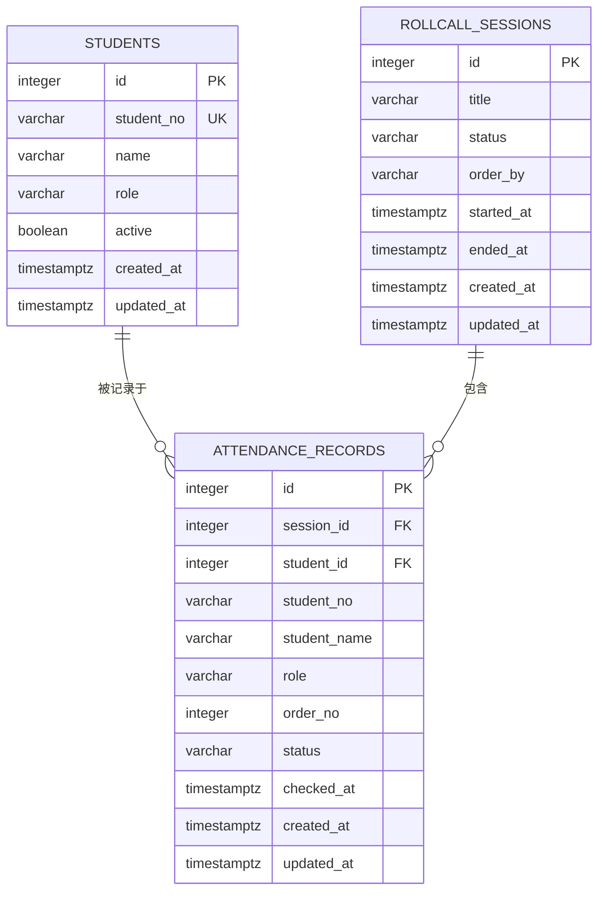

# 教师点名签到系统 · 数据库设计

> 文档版本：v1.0（设计阶段）
> 负责人：成员 C
> 契约来源：《总体架构.md》第 7 章。表名、字段名、枚举值必须与后端 API、前端字段完全一致。

---

## 1. 设计原则

1. **字段即契约**：数据库列名与 API JSON 字段名一致（`snake_case`），后端不做重命名映射。
2. **历史不可变**：签到记录保存学生姓名、学号、角色快照，学生信息变更不影响历史。
3. **单一事实来源**：签到与缺勤共用 `attendance_records`，用 `status` 区分，避免两表不一致。
4. **约束下沉**：唯一性、外键、枚举值用数据库约束兜底，应用层校验用于友好提示。
5. **可迁移**：开发 SQLite、生产 PostgreSQL，通过 SQLAlchemy + Alembic 管理，禁止手工改生产表结构。

---

## 2. 实体关系



**关系说明**

- 一个学生可出现在多个场次的记录中（1:N）。
- 一个场次包含多条记录（1:N）。
- `(session_id, student_id)` 唯一，保证同一场次同一学生只有一条记录。
- `student_id` 外键指向学生，但记录同时保存快照；学生采用软删除，不破坏外键。

---

## 3. 表结构

### 3.1 `students`（学生名单）

| 列 | 类型（PostgreSQL） | 可空 | 默认 | 说明 |
| --- | --- | --- | --- | --- |
| `id` | `BIGSERIAL` | 否 | 自增 | 主键 |
| `student_no` | `VARCHAR(32)` | 否 | — | 学号，全局唯一 |
| `name` | `VARCHAR(32)` | 否 | — | 姓名 |
| `role` | `VARCHAR(16)` | 否 | `'学生'` | `学生`/`班长`/`教师` |
| `active` | `BOOLEAN` | 否 | `TRUE` | 是否在册；删除为软删除 |
| `created_at` | `TIMESTAMPTZ` | 否 | `now()` | 创建时间（UTC） |
| `updated_at` | `TIMESTAMPTZ` | 否 | `now()` | 更新时间（UTC） |

**约束**

- `PRIMARY KEY (id)`
- `UNIQUE (student_no)`：学号全局唯一，软删除后不可复用（保证历史可追溯）
- `CHECK (role IN ('学生', '班长', '教师'))`
- `CHECK (char_length(student_no) BETWEEN 1 AND 32)`
- `CHECK (char_length(name) BETWEEN 1 AND 32)`

**索引**

- `idx_students_active_no (active, student_no)`：默认名单查询与排序。
- 唯一索引已覆盖 `student_no` 精确查找。

---

### 3.2 `rollcall_sessions`（点名场次）

| 列 | 类型 | 可空 | 默认 | 说明 |
| --- | --- | --- | --- | --- |
| `id` | `BIGSERIAL` | 否 | 自增 | 主键 |
| `title` | `VARCHAR(64)` | 否 | — | 场次标题 |
| `status` | `VARCHAR(16)` | 否 | `'calling'` | `calling` / `ended` |
| `order_by` | `VARCHAR(16)` | 否 | `'student_no'` | `student_no` / `name` / `id` |
| `started_at` | `TIMESTAMPTZ` | 否 | `now()` | 开始时间 |
| `ended_at` | `TIMESTAMPTZ` | 是 | `NULL` | 结束时间；进行中为 NULL |
| `created_at` | `TIMESTAMPTZ` | 否 | `now()` | 创建时间 |
| `updated_at` | `TIMESTAMPTZ` | 否 | `now()` | 更新时间 |

**约束**

- `PRIMARY KEY (id)`
- `CHECK (status IN ('calling', 'ended'))`
- `CHECK (order_by IN ('student_no', 'name', 'id'))`
- `CHECK (char_length(title) BETWEEN 1 AND 64)`
- `CHECK (ended_at IS NULL OR ended_at >= started_at)`
- `CHECK (status = 'calling' AND ended_at IS NULL) OR (status = 'ended' AND ended_at IS NOT NULL)`

**索引**

- `idx_sessions_started (started_at DESC, id DESC)`：历史列表排序。
- `idx_sessions_status (status)`：按状态过滤。

> 统计字段（总人数/已签到/缺勤/待签到）**不落库**，由后端实时聚合，避免冗余不一致。若后续性能不足，再增加缓存字段并纳入契约变更。

---

### 3.3 `attendance_records`（签到/缺勤记录）

| 列 | 类型 | 可空 | 默认 | 说明 |
| --- | --- | --- | --- | --- |
| `id` | `BIGSERIAL` | 否 | 自增 | 主键 |
| `session_id` | `BIGINT` | 否 | — | 场次 ID，外键 |
| `student_id` | `BIGINT` | 否 | — | 学生 ID，外键 |
| `student_no` | `VARCHAR(32)` | 否 | — | 学号快照 |
| `student_name` | `VARCHAR(32)` | 否 | — | 姓名快照 |
| `role` | `VARCHAR(16)` | 否 | — | 角色快照 |
| `order_no` | `INTEGER` | 否 | — | 点名顺序，从 1 开始 |
| `status` | `VARCHAR(16)` | 否 | `'pending'` | `pending` / `present` / `absent` |
| `checked_at` | `TIMESTAMPTZ` | 是 | `NULL` | 签到时间；缺勤为结束时间；pending 为 NULL |
| `created_at` | `TIMESTAMPTZ` | 否 | `now()` | 创建时间 |
| `updated_at` | `TIMESTAMPTZ` | 否 | `now()` | 更新时间 |

**约束**

- `PRIMARY KEY (id)`
- `FOREIGN KEY (session_id) REFERENCES rollcall_sessions(id) ON DELETE CASCADE`
- `FOREIGN KEY (student_id) REFERENCES students(id) ON DELETE RESTRICT`
- `UNIQUE (session_id, student_id)`：同一场次同一学生唯一
- `UNIQUE (session_id, order_no)`：同一场次点名顺序唯一
- `CHECK (status IN ('pending', 'present', 'absent'))`
- `CHECK (order_no >= 1)`
- `CHECK (status = 'present' AND checked_at IS NOT NULL) OR (status <> 'present')`
- `CHECK (char_length(student_no) BETWEEN 1 AND 32)`
- `CHECK (char_length(student_name) BETWEEN 1 AND 32)`
- `CHECK (role IN ('学生', '班长', '教师'))`

**索引**

- `idx_records_session_status_order (session_id, status, order_no)`：按状态筛选签到/缺勤、按顺序展示。
- `idx_records_session_order (session_id, order_no)`：场次详情排序。
- `idx_records_student (student_id)`：按学生查历史（P1）。
- 唯一约束 `(session_id, student_id)` 自带索引，签到原子更新可命中。

---

## 4. 枚举与状态字典

| 枚举 | 取值 | 含义 |
| --- | --- | --- |
| `students.role` | `学生` / `班长` / `教师` | 名单角色 |
| `rollcall_sessions.status` | `calling` / `ended` | 点名进行中 / 已结束 |
| `rollcall_sessions.order_by` | `student_no` / `name` / `id` | 点名顺序依据 |
| `attendance_records.status` | `pending` / `present` / `absent` | 待签到 / 已签到 / 缺勤 |

**状态流转（数据库视角）**

```text
创建场次：  (无) ──插入──> pending
签到：      pending ──UPDATE──> present（checked_at = 签到时间）
结束点名：  pending ──UPDATE──> absent（checked_at = 结束时间）
已结束场次：present / absent 不再变化（应用层禁止）
```

---

## 5. DDL（PostgreSQL 方言）

> 以下为逻辑设计 DDL，用于评审与 Alembic 迁移编写；本阶段不落地为可执行项目文件。

```sql
CREATE TABLE students (
    id          BIGSERIAL PRIMARY KEY,
    student_no  VARCHAR(32) NOT NULL,
    name        VARCHAR(32) NOT NULL,
    role        VARCHAR(16) NOT NULL DEFAULT '学生',
    active      BOOLEAN NOT NULL DEFAULT TRUE,
    created_at  TIMESTAMPTZ NOT NULL DEFAULT now(),
    updated_at  TIMESTAMPTZ NOT NULL DEFAULT now(),
    CONSTRAINT uk_students_student_no UNIQUE (student_no),
    CONSTRAINT ck_students_role CHECK (role IN ('学生', '班长', '教师')),
    CONSTRAINT ck_students_no_len CHECK (char_length(student_no) BETWEEN 1 AND 32),
    CONSTRAINT ck_students_name_len CHECK (char_length(name) BETWEEN 1 AND 32)
);

CREATE INDEX idx_students_active_no ON students (active, student_no);

CREATE TABLE rollcall_sessions (
    id          BIGSERIAL PRIMARY KEY,
    title       VARCHAR(64) NOT NULL,
    status      VARCHAR(16) NOT NULL DEFAULT 'calling',
    order_by    VARCHAR(16) NOT NULL DEFAULT 'student_no',
    started_at  TIMESTAMPTZ NOT NULL DEFAULT now(),
    ended_at    TIMESTAMPTZ,
    created_at  TIMESTAMPTZ NOT NULL DEFAULT now(),
    updated_at  TIMESTAMPTZ NOT NULL DEFAULT now(),
    CONSTRAINT ck_sessions_status CHECK (status IN ('calling', 'ended')),
    CONSTRAINT ck_sessions_order_by CHECK (order_by IN ('student_no', 'name', 'id')),
    CONSTRAINT ck_sessions_title_len CHECK (char_length(title) BETWEEN 1 AND 64),
    CONSTRAINT ck_sessions_time CHECK (ended_at IS NULL OR ended_at >= started_at),
    CONSTRAINT ck_sessions_state CHECK (
        (status = 'calling' AND ended_at IS NULL)
        OR (status = 'ended' AND ended_at IS NOT NULL)
    )
);

CREATE INDEX idx_sessions_started ON rollcall_sessions (started_at DESC, id DESC);
CREATE INDEX idx_sessions_status ON rollcall_sessions (status);

CREATE TABLE attendance_records (
    id            BIGSERIAL PRIMARY KEY,
    session_id    BIGINT NOT NULL,
    student_id    BIGINT NOT NULL,
    student_no    VARCHAR(32) NOT NULL,
    student_name  VARCHAR(32) NOT NULL,
    role          VARCHAR(16) NOT NULL,
    order_no      INTEGER NOT NULL,
    status        VARCHAR(16) NOT NULL DEFAULT 'pending',
    checked_at    TIMESTAMPTZ,
    created_at    TIMESTAMPTZ NOT NULL DEFAULT now(),
    updated_at    TIMESTAMPTZ NOT NULL DEFAULT now(),
    CONSTRAINT fk_records_session FOREIGN KEY (session_id)
        REFERENCES rollcall_sessions (id) ON DELETE CASCADE,
    CONSTRAINT fk_records_student FOREIGN KEY (student_id)
        REFERENCES students (id) ON DELETE RESTRICT,
    CONSTRAINT uk_records_session_student UNIQUE (session_id, student_id),
    CONSTRAINT uk_records_session_order UNIQUE (session_id, order_no),
    CONSTRAINT ck_records_status CHECK (status IN ('pending', 'present', 'absent')),
    CONSTRAINT ck_records_order CHECK (order_no >= 1),
    CONSTRAINT ck_records_checked CHECK (
        (status = 'present' AND checked_at IS NOT NULL) OR (status <> 'present')
    ),
    CONSTRAINT ck_records_no_len CHECK (char_length(student_no) BETWEEN 1 AND 32),
    CONSTRAINT ck_records_name_len CHECK (char_length(student_name) BETWEEN 1 AND 32),
    CONSTRAINT ck_records_role CHECK (role IN ('学生', '班长', '教师'))
);

CREATE INDEX idx_records_session_status_order
    ON attendance_records (session_id, status, order_no);
CREATE INDEX idx_records_session_order
    ON attendance_records (session_id, order_no);
CREATE INDEX idx_records_student
    ON attendance_records (student_id);
```

### 5.1 SQLite 差异

| 项 | PostgreSQL | SQLite |
| --- | --- | --- |
| 自增主键 | `BIGSERIAL` | `INTEGER PRIMARY KEY AUTOINCREMENT` |
| 时间类型 | `TIMESTAMPTZ` | `TEXT`（ISO 8601）或 `DATETIME`，由 SQLAlchemy 适配 |
| 布尔 | `BOOLEAN` | `INTEGER`（0/1） |
| 字符长度检查 | `char_length` | `length` |
| 行锁 | `SELECT ... FOR UPDATE` | 不支持，靠条件更新与串行写 |
| 大小写/排序 | 数据库 collation | 默认二进制排序 |

> 统一由 SQLAlchemy 模型生成 SQLite 测试库；生产 DDL 以 PostgreSQL 为准。Alembic 迁移需同时兼容两种方言，必要时用 `batch_alter_table`。

---

## 6. 数据库接口（供后端调用）

> 本节是数据库模块对后端的**唯一数据访问契约**。后端 Repository 只能调用以下语义操作；SQL 由成员 C 维护，成员 B 不直接在 API 层写 SQL。

### 6.1 学生

| 操作 | 函数签名（Repository） | SQL 语义 | 返回 |
| --- | --- | --- | --- |
| 列表 | `list_students(db, keyword=None, active=True) -> list[Student]` | `WHERE active=:active [AND (name ILIKE %kw% OR student_no ILIKE %kw%)] ORDER BY student_no, id` | 学生列表 |
| 按 ID | `get_student(db, student_id) -> Student \| None` | `WHERE id=:id` | 单条或 None |
| 新增 | `create_student(db, student_no, name, role) -> Student` | `INSERT ... RETURNING *`（SQLite 用 flush + refresh） | 新学生 |
| 软删除 | `deactivate_student(db, student_id) -> bool` | `UPDATE students SET active=false, updated_at=:now WHERE id=:id AND active=true` | `rowcount==1` |
| 在册计数 | `count_active_students(db) -> int` | `SELECT count(*) FROM students WHERE active=true` | 整数 |
| 在册排序 | `list_active_students_ordered(db, order_by) -> list[Student]` | 按 `order_by` 白名单拼接排序 | 学生列表 |

**排序白名单（防注入）**

```text
student_no -> "student_no ASC, id ASC"
name       -> "name ASC, id ASC"
id         -> "id ASC"
```

### 6.2 场次

| 操作 | 函数签名 | SQL 语义 | 返回 |
| --- | --- | --- | --- |
| 创建 | `create_session(db, title, order_by, started_at) -> Session` | `INSERT INTO rollcall_sessions ... RETURNING *` | 场次 |
| 按 ID | `get_session(db, session_id, for_update=False) -> Session \| None` | `WHERE id=:id`；结束时加行锁 | 场次或 None |
| 结束 | `finish_session(db, session_id, ended_at) -> bool` | `UPDATE ... SET status='ended', ended_at=:t WHERE id=:id AND status='calling'` | `rowcount==1` |
| 分页 | `list_sessions(db, page, page_size, status=None) -> (list[Session], total)` | `ORDER BY started_at DESC, id DESC LIMIT/OFFSET` | 列表 + 总数 |
| 批量统计 | `aggregate_session_counts(db, session_ids) -> dict[int, dict]` | 按 `session_id` 分组统计 `present/absent/pending` | 统计字典 |

### 6.3 记录

| 操作 | 函数签名 | SQL 语义 | 返回 |
| --- | --- | --- | --- |
| 批量创建 | `bulk_create_records(db, rows) -> None` | 一条 `INSERT` 多值，`order_no` 从 1 递增，`status='pending'` | — |
| 场次记录 | `list_records(db, session_id, status=None) -> list[Record]` | `WHERE session_id=:id [AND status=:s] ORDER BY order_no` | 记录列表 |
| 单条记录 | `get_record(db, session_id, student_id) -> Record \| None` | `WHERE session_id=:sid AND student_id=:stid` | 记录或 None |
| 签到 | `mark_present(db, session_id, student_id, checked_at) -> int` | `UPDATE ... SET status='present', checked_at=:t WHERE session_id=:sid AND student_id=:stid AND status='pending'` | `rowcount` |
| 转缺勤 | `mark_pending_absent(db, session_id, ended_at) -> int` | `UPDATE ... SET status='absent', checked_at=:t WHERE session_id=:sid AND status='pending'` | `rowcount` |
| 统计 | `count_records_by_status(db, session_id) -> dict[str,int]` | `SELECT status, count(*) ... GROUP BY status` | 字典 |

### 6.4 事务边界（由后端 Service 控制）

| 业务 | 事务内操作 |
| --- | --- |
| 添加学生 | `create_student` → commit |
| 开始点名 | `create_session` → `bulk_create_records` → commit（异常回滚） |
| 签到 | `mark_present` → 查询记录 → commit |
| 结束点名 | `get_session(for_update)` → `finish_session` → `mark_pending_absent` → 统计/查询 → commit |

> 建议顺序：先结束场次再转缺勤，或反之，均在同一事务；两者都以 `status` 条件更新保证幂等。

---

## 7. 关键 SQL 示例

### 7.1 开始点名：批量插入记录

```sql
INSERT INTO attendance_records
    (session_id, student_id, student_no, student_name, role, order_no, status)
VALUES
    (:session_id, :student_id_1, :no_1, :name_1, :role_1, 1, 'pending'),
    (:session_id, :student_id_2, :no_2, :name_2, :role_2, 2, 'pending');
```

### 7.2 签到（原子）

```sql
UPDATE attendance_records
SET status = 'present', checked_at = :now, updated_at = :now
WHERE session_id = :session_id
  AND student_id = :student_id
  AND status = 'pending';
```

### 7.3 结束点名

```sql
UPDATE attendance_records
SET status = 'absent', checked_at = :ended_at, updated_at = :ended_at
WHERE session_id = :session_id
  AND status = 'pending';

UPDATE rollcall_sessions
SET status = 'ended', ended_at = :ended_at, updated_at = :ended_at
WHERE id = :session_id
  AND status = 'calling';
```

### 7.4 场次统计（列表页批量）

```sql
SELECT
    s.id,
    s.title,
    s.status,
    s.started_at,
    s.ended_at,
    COUNT(r.id)                                        AS total_count,
    COUNT(r.id) FILTER (WHERE r.status = 'present')    AS present_count,
    COUNT(r.id) FILTER (WHERE r.status = 'absent')     AS absent_count,
    COUNT(r.id) FILTER (WHERE r.status = 'pending')    AS pending_count
FROM rollcall_sessions s
LEFT JOIN attendance_records r ON r.session_id = s.id
WHERE (:status IS NULL OR s.status = :status)
GROUP BY s.id
ORDER BY s.started_at DESC, s.id DESC
LIMIT :limit OFFSET :offset;
```

> SQLite 不支持 `FILTER`，可用 `SUM(CASE WHEN r.status='present' THEN 1 ELSE 0 END)`，Alembic/SQLAlchemy 层按方言选择。为兼容，推荐统一使用 `SUM(CASE WHEN ...)`。

### 7.5 一致性校验（运维/测试）

```sql
-- 每个已结束场次不应有 pending
SELECT session_id, COUNT(*) AS pending_cnt
FROM attendance_records
WHERE status = 'pending'
GROUP BY session_id
HAVING COUNT(*) > 0;

-- 统计与明细应一致
SELECT s.id,
       COUNT(r.id) AS total,
       SUM(CASE WHEN r.status='present' THEN 1 ELSE 0 END) AS present,
       SUM(CASE WHEN r.status='absent'  THEN 1 ELSE 0 END) AS absent,
       SUM(CASE WHEN r.status='pending' THEN 1 ELSE 0 END) AS pending
FROM rollcall_sessions s
LEFT JOIN attendance_records r ON r.session_id = s.id
WHERE s.status = 'ended'
GROUP BY s.id
HAVING SUM(CASE WHEN r.status='pending' THEN 1 ELSE 0 END) <> 0;
```

---

## 8. 迁移与版本管理

- 工具：Alembic，迁移文件置于 `database/migrations/` 或 `backend/alembic/versions/`（二者择一，评审后固定）。
- 命名：`0001_create_students.py`、`0002_create_rollcall_sessions.py`、`0003_create_attendance_records.py`。
- 规则：
  1. 只允许向前迁移；破坏性变更必须提供回滚脚本与数据备份说明。
  2. 迁移脚本必须可在空库与已有数据库上执行。
  3. 生产执行前先在测试库跑一遍，并校验第 7.5 节一致性 SQL。
- 初始化：`alembic upgrade head`。
- 禁止使用 `create_all()` 管理生产表结构（仅测试可用）。

---

## 9. 种子数据（开发/演示）

```sql
INSERT INTO students (student_no, name, role) VALUES
    ('20230001', '张三', '学生'),
    ('20230002', '李四', '学生'),
    ('20230003', '王五', '班长');
```

- 种子脚本必须幂等：先按 `student_no` 判断是否存在，或使用 `ON CONFLICT DO NOTHING`（PostgreSQL）/ `INSERT OR IGNORE`（SQLite）。
- 不写入任何场次与记录，避免演示时出现脏历史。
- 演示流程建议：用上述 3 人生成一场点名，1 人签到、1 人缺勤，便于验收。

---

## 10. 备份、恢复与运维

| 项 | 方案 |
| --- | --- |
| PostgreSQL 备份 | 每日 `pg_dump -Fc`，保留 7 天；重要场次后可手动备份 |
| SQLite 备份 | 停机复制数据库文件，或 `sqlite3 .backup` |
| 恢复演练 | 每学期至少一次恢复到测试库并跑一致性 SQL |
| 账号权限 | 应用账号仅 DML + 序列；迁移账号具备 DDL；禁止应用账号 `DROP` |
| 连接池 | SQLAlchemy `pool_size=5, max_overflow=10`（生产）；SQLite 单连接 |
| 监控 | 慢查询日志（> 500ms）、表空间增长、场次记录数异常 |

---

## 11. 容量与性能估算

- 单课堂 200 人，每次点名 200 条记录。
- 每周 20 场 × 一学期 20 周 = 400 场 ≈ 8 万条记录/学期，数据量极小。
- 关键查询均有索引覆盖：
  - 场次详情：`(session_id, order_no)`
  - 签到/缺勤筛选：`(session_id, status, order_no)`
  - 历史列表：`(started_at DESC, id DESC)`
- 单场次详情 P95 目标 < 100ms；签到 P95 < 50ms（不含网络）。

---

## 12. 数据库验收标准

- [ ] 三张表字段名、类型、可空、默认值与第 3 章完全一致。
- [ ] 唯一约束 `(session_id, student_id)`、`(session_id, order_no)`、`students.student_no` 生效。
- [ ] 枚举 CHECK 约束生效，非法状态无法写入。
- [ ] `present` 记录必有 `checked_at`；`pending` 的 `checked_at` 为空。
- [ ] 开始点名后 `order_no` 从 1 连续递增，无重复。
- [ ] 结束点名后该场次无 `pending`，且 `present + absent = total`。
- [ ] 删除学生为软删除，历史记录仍可查询。
- [ ] 迁移可在空库与已有数据库执行成功。
- [ ] 第 7.5 节一致性 SQL 返回空结果。
- [ ] Repository 函数签名与第 6 章一致，后端未绕过 Repository 直接拼 SQL。